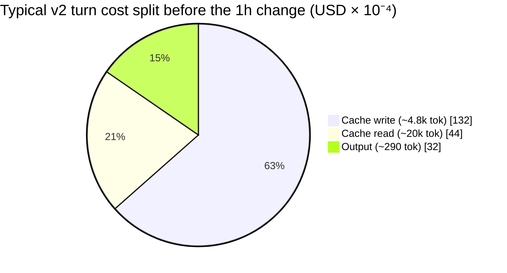
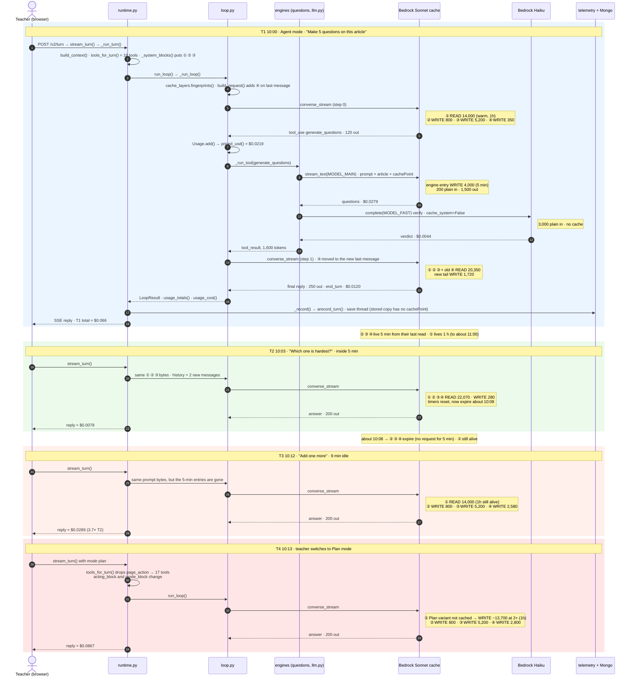
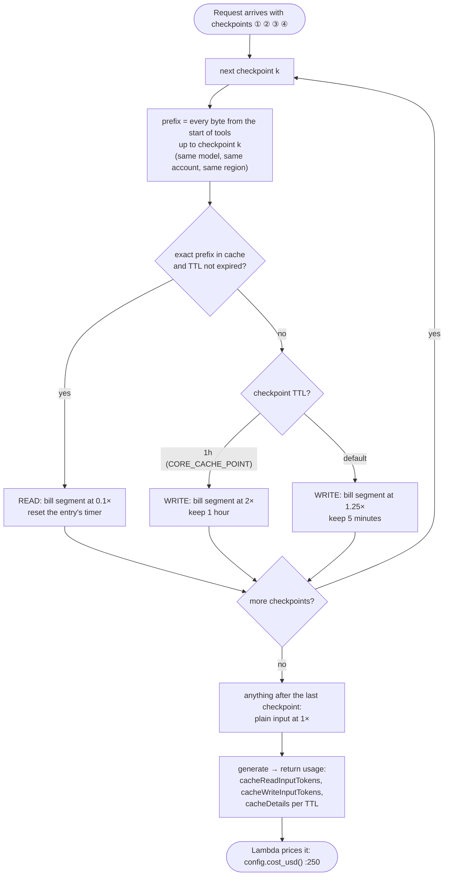
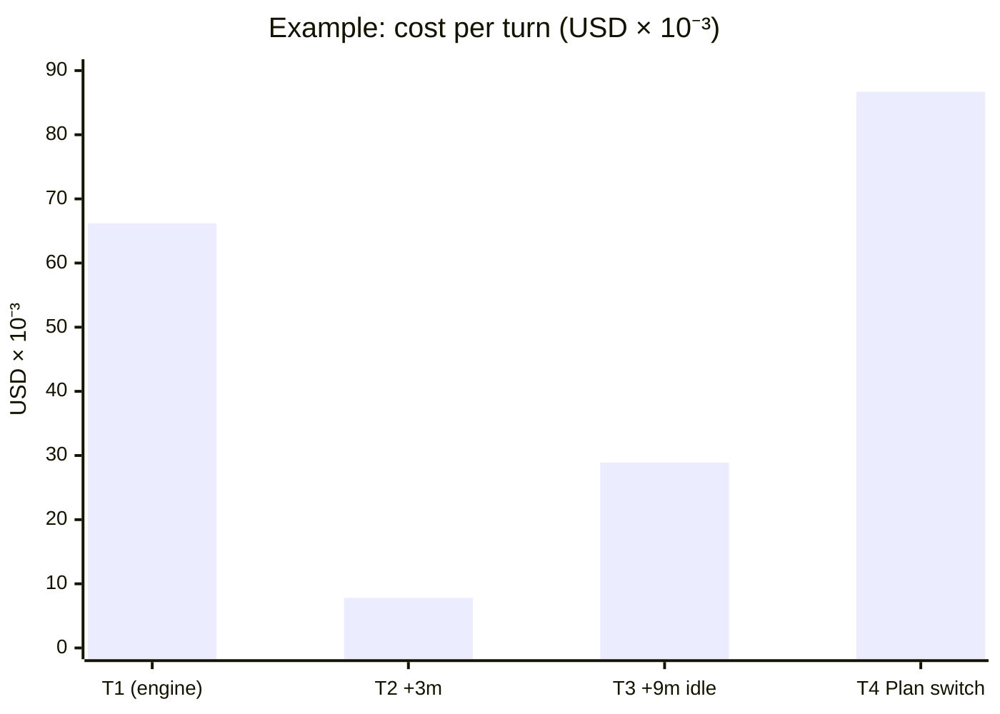

# Bedrock prompt caching in Scout AI: who writes the cache, where the boundaries are, and what it costs

Companion to [AI-Code-Audit-Plan.md](AI-Code-Audit-Plan.md), §3.1 and checklist A3.

Code references are to `rag/lambdas/ai_assistant/src/` on branch `ONLINE-5385_scout_ai_integration`, commit
`86d92ea0` (2026-10-05).

> **The cache layout changed after the audit plan's baseline (`5dbb9b18`).** It now has:
>
> - a **1-hour** checkpoint on the core (tools + constitution)
> - a separate **teacher** layer
> - no separate tools checkpoint
>
> This file describes the current code.

---

## 1. Who writes the cache

**Amazon Bedrock writes and stores the cache, not any of our services.** Our code only marks where
each cacheable part of the prompt ends. Bedrock does the storing, matching and billing.

| Who | What it does | Where |
|---|---|---|
| **rag `ai_assistant` Lambda** (our code) | Adds `cachePoint` markers to the request it sends to Bedrock. A marker means "everything before this point can be cached". | §3 below |
| **Amazon Bedrock** (AWS) | Checks whether the content up to each marker is already cached. If it is, it reads it (0.1× price). If not, it processes it and stores it (1.25× for 5 min, 2× for 1 h). | AWS-managed memory inside Bedrock. We can't see it or manage it. |
| **Bedrock's response** | Reports `cacheReadInputTokens`, `cacheWriteInputTokens` and a per-TTL `cacheDetails` list in its usage data. | Returned on every `converse_stream` call |
| **rag telemetry** | Records those counts, calculates the cost, and fingerprints each layer. | `core/telemetry.py:108-111`, `core/config.py:265-272`, `core/cache_layers.py` |

> The cache is **not** in MongoDB, DynamoDB or Redis. None of our databases are involved. Mongo stores
> the conversation history; Bedrock caches the processed version of the prompt.

---

## 2. The request layout and where each boundary sits

Bedrock reads a request in this order: **tools → system → messages**. A checkpoint caches **everything
before it**, including the tools.

```mermaid
flowchart LR
    subgraph TOOLS["toolConfig.tools"]
        T["17-18 tool specs<br/>(page_action only in Agent mode)"]
    end
    subgraph SYS["system blocks (_system_blocks)"]
        C["CONSTITUTION"] --> CP1(["① CORE_CACHE_POINT<br/>ttl 1h"])
        CP1 --> TE["teacher block<br/>(what Scout knows about the teacher)"] --> CP2(["② CACHE_POINT<br/>5 min"])
        CP2 --> PG["page · article · capabilities<br/>+ acting_block(mode)"] --> CP3(["③ CACHE_POINT<br/>5 min"])
        CP3 --> LV["scope · history_summary<br/>+ mode_block(mode)<br/>NOT cached"]
    end
    subgraph MSG["messages"]
        H["history (last 40)"] --> CP4(["④ CACHE_POINT on last message<br/>5 min"])
    end
    T --> C
    LV --> H
    style CP1 fill:#dbeafe,stroke:#1d4ed8
    style CP2 fill:#e2f5e2,stroke:#15803d
    style CP3 fill:#e2f5e2,stroke:#15803d
    style CP4 fill:#e2f5e2,stroke:#15803d
    style LV fill:#f3f4f6,stroke:#6b7280
```



| # | Checkpoint | What it caches (everything before it) | TTL | Shared across | Changes when |
|---|---|---|---|---|---|
| ① | `CORE_CACHE_POINT` after the constitution | tool specs + constitution | **1 hour** | every teacher on every page, **per mode** (the tool list differs) | a deploy changes a tool or the constitution; Plan↔Agent picks the other variant |
| ② | `CACHE_POINT` after the teacher block | ① + teacher block | 5 min | one teacher | teacher memory or context changes |
| ③ | `CACHE_POINT` after page + `acting_block` | ② + page, article, capabilities, mode wording | 5 min | one teacher on one page in one mode | the page data changes, the teacher navigates, or the mode changes |
| ④ | `CACHE_POINT` on the last history message | ③ + live blocks + conversation so far | 5 min | one thread | every new message (the next step reads up to here) |

At most 4 checkpoints per request (Bedrock's limit). When the teacher block is missing, ② is skipped, and
the history checkpoint still fits.

---

## 3. Where the boundaries are defined in our code

### 3.1 The two marker constants: `core/loop.py:36-38`

```python
CACHE_POINT = {"cachePoint": {"type": "default"}}
#: The tools and the core are the same for every teacher on every page, so they are kept for an hour, not five minutes.
CORE_CACHE_POINT = {"cachePoint": {"type": "default", "ttl": "1h"}}
```

These are the only two shapes the v2 loop sends. `CORE_CACHE_POINT` asks Bedrock for the 1-hour TTL.

### 3.2 System-prompt boundaries ①②③: `core/runtime.py:1415-1440`, `_system_blocks()`

```python
def _system_blocks(built: Any, mode: str, prompt_cache: bool) -> List[Dict[str, Any]]:
    """Core, teacher, page, live: each layer cached after the one later turns share more often.
    Tools render before the system text, so the core's one-hour checkpoint caches both."""
    system: List[Dict[str, Any]] = [{"text": CONSTITUTION}]
    if prompt_cache:
        system.append(CORE_CACHE_POINT)                      # ① tools + constitution, 1h
    blocks = list(built.blocks()) if built is not None else []
    teacher = [b for b in blocks if b.name == "teacher"]
    cached = [b for b in blocks if getattr(b, "cache", False) and b.name != "teacher"]
    live = [b for b in blocks if not getattr(b, "cache", False)]
    for block in teacher:
        system.append({"text": block.text})
    if prompt_cache and teacher:
        system.append(CACHE_POINT)                           # ② teacher, 5 min
    for block in cached:
        system.append({"text": block.text})
    system.append({"text": acting_block(mode)})
    if prompt_cache:
        system.append(CACHE_POINT)                           # ③ page + acting wording, 5 min
    for block in live:
        system.append({"text": block.text})                  # not cached
    system.append({"text": mode_block(mode)})                # not cached
```

The comments marked ①②③ are added here for this doc; they are not in the source. The call site is
`core/runtime.py:2071`. Extra per-turn blocks (`made_earlier_blocks`, `carried_over_block`,
`regenerate_block`) are added **after** these, so they can't break the cached layers.

### 3.3 Which context blocks count as cacheable: the `cache` flag

`core/context/types.py:10-20`:

```python
@dataclass
class ContextBlock:
    """One markdown block of the system prompt.

    `cache` marks a block whose text is stable across turns on the same page, so
    the loop can put a Bedrock `cachePoint` after the last cacheable block.
    """

    name: str
    text: str
    cache: bool = True
```

`core/context/types.py:118-121` sets the order the blocks come in:

```python
def blocks(self) -> List[ContextBlock]:
    """System blocks in prompt order: stable page material first, then per-turn."""
    ordered = [self.page, self.article, self.capabilities, self.scope, self.teacher, self.history_summary]
    return [b for b in ordered if b is not None and b.text.strip()]
```

Where each block sets its flag:

| Block | `cache` | Defined at |
|---|---|---|
| `page` | `True` | `core/context/page.py:234` (fallback `core/runtime.py:1408`) |
| `article` | `True` | `core/context/article.py:133` |
| `capabilities` | `True` | `core/context/build.py:184` |
| `teacher` | `True` (pulled into its own layer ②) | `core/context/teacher.py:385, 556` |
| `scope` | **`False`** | `core/context/build.py:91` (fallback `core/runtime.py:1410`) |
| `history_summary` | **`False`** | `core/context/build.py:296` |

### 3.4 Tools boundary and history boundary ④: `core/loop.py:180-222`, `build_request()`

```python
#: Bedrock accepts at most four cache checkpoints per request (tools, system and messages together).
MAX_CACHE_POINTS = 4


def with_history_cache_point(messages: List[Dict[str, Any]]) -> List[Dict[str, Any]]:
    """A copy whose last message ends with a `cachePoint`; the stored history never carries one.

    The next call (a tool step, or the next turn within the cache's five minutes) sends the same
    messages plus a few more, and Bedrock's lookback finds this checkpoint within 20 blocks, so the
    conversation so far is read at the cache-read rate instead of re-billed as fresh input.
    """
    if not messages:
        return messages
    last = messages[-1]
    content = list(last.get("content") or [])
    if not content or "cachePoint" in content[-1]:
        return messages
    return [*messages[:-1], {**last, "content": [*content, CACHE_POINT]}]


def build_request(*, cfg, model, system_blocks, tool_specs, messages, history_cache: bool = True):
    ...
    points = sum(1 for block in system_blocks if "cachePoint" in block)
    if tool_specs:
        tools = [{"toolSpec": spec} for spec in tool_specs]
        # The tools render before the system text, so a system checkpoint already caches them.
        if cfg.prompt_cache and not points:
            tools.append(CACHE_POINT)          # only when the system has no checkpoint
            points += 1
        request["toolConfig"] = {"tools": tools}
    if cfg.prompt_cache and history_cache and points < MAX_CACHE_POINTS:
        request["messages"] = with_history_cache_point(sent)   # ④
```

The tools get their own marker **only** when the system has none. Normally ① already covers them. Callers:
`core/loop.py:1047` (each loop step), `core/loop.py:1208`, `core/runtime.py:1956` (lead request).

### 3.5 Tool order must stay stable: `core/tools/__init__.py`

```python
"""...The order here is the order the model
sees, and it must stay stable across turns so the tools `cachePoint` holds.
"""
TOOL_MODULES = ("search_curriculum", "offer_match", ..., "page_action", "remember", "forget", "suggest_standards")

#: Offered only in Agent mode; in Plan mode the model describes what it would do.
AGENT_ONLY = frozenset({"page_action"})

def tools_for_turn(ctx: TurnContext) -> List[CoreTool]:
    return [tool for tool in load_tools() if ctx.is_agent or tool.name not in AGENT_ONLY]
```

Because the tools come before ①, **Plan and Agent mode each have their own 1-hour core entry**. The first
switch to the other mode in an hour pays a 1-hour write (2×) on about 14k tokens.

### 3.6 The constitution must stay byte-for-byte the same: `core/prompts/constitution.py:7-8`

```python
The text is byte-stable: it sits before the first `cachePoint`, so anything that
varies per turn (mode, date, page) belongs in the context blocks, never here.
```

Two checks enforce this: `tests/core/check_prompt_registry.py` and `tests/core/check_request_text_pin.py`.
The mode-specific text lives in `acting_block(mode)` (inside ③) and `mode_block(mode)` (uncached),
`constitution.py:125-150`.

### 3.7 Global on switch: `core/config.py:105, 190`

```python
prompt_cache: bool          # field on CoreConfig
...
prompt_cache=True,          # hard-coded, no env override
```

### 3.8 Engines (level, questions, compose): `core/engines/llm.py:135-142`

```python
def _request(model, system, messages, max_tokens, thinking, cache_system, tool_config=None, temperature=None):
    blocks: List[Dict[str, Any]] = []
    for part in system:
        blocks.append({"text": part})
    if cache_system and blocks:
        blocks.append({"cachePoint": {"type": "default"}})   # one 5-min checkpoint after the engine's system prompt
```

- Streaming engine calls default to `cache_system=True` (`llm.py:337`).
- Non-streaming calls default to `False` (`llm.py:374`).
- The article goes **inside** the cached system prompt on purpose, so a repair or verify pass on the same
  article reads it instead of writing it again (`core/engines/questions.py:273`, `core/prompts/engines/compose.py:112`).

### 3.9 Cost of the 1-hour write: `core/config.py:265-272`

```python
# A one-hour checkpoint's write is billed at twice the input rate; Bedrock reports it under `cacheDetails`.
written_1h = sum(int(d.get("inputTokens") or 0) for d in usage.get("cacheDetails") or [] if d.get("ttl") == "1h")
written = tokens("cacheWriteInputTokens", "cache_write")
return round((tokens("inputTokens", "input") * price["input"]
              + tokens("outputTokens", "output") * price["output"]
              + tokens("cacheReadInputTokens", "cache_read") * price["cache_read"]
              + (written - written_1h) * price["cache_write"]
              + written_1h * price["cache_write_1h"]) / 1_000_000, 8)
```

### 3.10 Measuring each layer: `core/cache_layers.py`

Bedrock reports only a request's **total** cache reads and writes. It never says which checkpoint they came
from. This module logs a hash and a character count for each layer (`instructions`, `teacher`, `page`,
plus `tools`), never the text itself:

```python
LAYERS = ("instructions", "teacher", "page")

def fingerprints(system_blocks, tool_specs, messages) -> Dict[str, Any]:
    ...
    # The prefix up to each checkpoint is what is cached, so a layer's key is everything before its checkpoint.
    for name, segment in zip(names, segments):
        prefix += segment
        out[f"cache_{name}_h"], out[f"cache_{name}_chars"] = _fingerprint(prefix), len(segment)
```

If two turns share a fingerprint within the TTL, that layer was read. If a fingerprint never comes back in
time, that layer paid the write premium for nothing.

### 3.11 v1 (gateway doors, Nova): `services/assistant_llm_service.py:488-498`

```python
# ⚠️ Tool-list caching was tried and reverted here. AWS's own
# per-model field-support table for prompt caching lists `tools`
# as a cacheable field for Claude and GPT-5.6, and lists no Nova
# row at all. Verified live 2026-08-24: a `cachePoint` entry
# inside `toolConfig.tools` for `us.amazon.nova-lite-v1:0` is
# rejected outright ... System-prompt caching (below, via cacheable_system_content
# in assistant_agent.py) is unaffected and is what this ships.
```

The same comment is at `:660-670`. On v1, only the system prompt is cached (through `cacheable_system_content`
in `agents/assistant_agent.py`); the tool list is not.

---

## 4. How Bedrock matches the cache

- **Exact prefix match.** A cache read happens only if every byte from the start of the request (the tools)
  up to the marker is identical. If one character changes early in the request, everything after it is
  written again.
- **Scope.** The cache belongs to our AWS account, one model and one region. Sonnet and Haiku keep
  separate caches.
- **Lifetime.** 5 minutes, or 1 hour for ①. Every read resets the timer.
- **Privacy.** Teacher B can only get a cache read on teacher A's entry by sending exactly the same bytes,
  so the cache can't leak one teacher's data to another. Only ① (tools + constitution) is the same for
  everyone.

---

## 5. Are cache tokens billed?

Yes. The price table is at `core/config.py:32-36`. Its rates are what Bedrock actually charged this
account (Cost Explorer, us-west-2, 2026-09):

| Token type | Sonnet 5 ($/1M) | Haiku 4.5 ($/1M) | Compared with normal input |
|---|---|---|---|
| Normal input | 2.20 | 1.10 | 1× |
| Cache write, 5 min | 2.75 | 1.375 | 1.25× |
| **Cache write, 1 hour** (layer ①) | **4.40** | **2.20** | **2×** |
| Cache read | 0.22 | 0.11 | 0.1× |
| Output | 11.00 | 5.50 | — |

### Why caching matters

Every model call sends the whole prompt again: tools, the constitution, the teacher and page context, and
up to 40 messages of history. That is about 25k input tokens per turn.

For a typical turn measured **before** the 1-hour change (`rag/experiments/cost_speed_7526`: about 20k read,
4.8k written, 290 output):

| | With caching | Without caching |
|---|---|---|
| Input | 20k × 0.22 + 4.8k × 2.75 → **$0.0176** | 24.8k × 2.20 → **$0.0546** |
| Output | $0.0032 | $0.0032 |
| **Total per turn** | **≈ $0.021** | **≈ $0.058** |



**Effect of the 1-hour core layer.** About 14k tokens (tools + constitution) now cost **$0.0616** per write
instead of $0.0385, but the entry should only be written about once an hour per mode across **all**
teachers, instead of after every 5-minute gap. That pays off whenever the core would otherwise be written
again more than about 1.6 times per hour. Check it with the A3.4 item in §7.

---

## 6. What forces a cache write

| Event | Layers written again | Why |
|---|---|---|
| Deploy changes a tool spec or the constitution | ① ② ③ ④ for everyone, once per mode | prefix changed at the very start |
| First Plan↔Agent switch in an hour | ① (2× write) and everything after it | `page_action` is added to or removed from the tool list |
| Any Plan↔Agent switch | ③ ④ | `acting_block(mode)` sits inside ③ |
| Teacher memory or context changes (`remember`/`forget`) | ② ③ ④ | teacher block text changed |
| Navigate to another page, or the page data changes between action legs | ③ ④ | page/article/capabilities text changed |
| Teacher idle for more than 5 min | ② ③ ④ | 5-minute TTL expired (① survives up to 1 h) |
| Each new turn | only the newly added messages after ④ | expected; earlier history is read |

---

## 7. Audit checks that come from this

| ID | Check | How |
|---|---|---|
| A3.1 | Which layer causes each cache write | Join `cache_tools_h` / `cache_instructions_h` / `cache_teacher_h` / `cache_page_h` from `core/cache_layers.py` with `cache_write_tokens` per call |
| A3.2 | Cost of Plan↔Agent switches | Count 1h writes (`cacheDetails` ttl=1h) around mode switches. If they are frequent, consider sending `page_action` in both modes and refusing it in code, so ① is a single entry |
| A3.3 | Page card changes between action legs bust ③ | `__chain.ts` with an action that changes the page; compare `cache_page_h` across legs |
| A3.4 | Does the 1-hour core pay off | Core writes per hour per mode in prod. Below about 1.6 per hour, the 1-hour TTL costs more than the 5-minute one would |
| A3.5 | Engine caching | Hit rate per engine. Non-streaming engine calls default to `cache_system=False` (`llm.py:374`); check whether any of them repeat the same article |
| A3.6 | v1 caches the system prompt only | `assistant_llm_service.py:488-498`. Measure v1 cache-read share; the tool list is billed in full on every Nova call |
| A3.7 | Cache cost matches the bill | Sum telemetry `cost_usd` for one day and compare with the Cost Explorer Bedrock usage types (input, output, cache-read, cache-write, cache-write-1h) for the same day |
| A3.8 | No per-turn text before a checkpoint | `check_request_text_pin.py` covers the constitution. Add a check that nothing time- or request-dependent (dates, ids) enters the page or teacher blocks |

---

## 8. Worked example: one conversation, step by step

This traces a real call path through the current code (`rag` @ `86d92ea0`), using one example
conversation.

> **The token counts are illustrative.** They are round sizes picked to show the mechanism, not
> measurements. Prices are Sonnet 5 / Haiku 4.5 from §5. Function names and line numbers are real.

**Setup.** A teacher is in **Agent mode** on a **Grade 4 article page** and has a short teacher-memory
block. Another teacher used Agent mode in the last hour, so layer ① is already warm in Bedrock.

| Prompt part | Tokens (illustrative) | Layer |
|---|---|---|
| 18 tool specs + constitution | 14,000 | ① (1 h) |
| teacher block | 800 | ② |
| page + article + capabilities + `acting_block` | 5,200 | ③ |
| scope + `mode_block` (uncached live blocks) | 300 | goes into ④'s segment |

**Conversation:**

| Turn | Time | Teacher says | What happens |
|---|---|---|---|
| T1 | 10:00 | "Make 5 questions on this article" | model calls `generate_questions` → engine → model writes the reply |
| T2 | 10:03 | "Which one is hardest?" | model answers directly |
| T3 | 10:12 | "Add one more" (9 min idle) | 5-min layers have expired |
| T4 | 10:13 | switches to **Plan** mode, asks again | other ① variant |

### 8.0 Which diagram shows what

The example is drawn three ways, because each kind of diagram answers a different question:

| What you want to see | Diagram | Why that kind |
|---|---|---|
| Who calls whom, in what order, and how cache entries live across turns (T1 writes, T2 reads, T3 has expired) | **Sequence**, §8.1 | Each component has a lifeline and time runs down the page, so the two Bedrock calls in one turn, the engine's own cache entry and the 5-minute / 1-hour gaps between turns are all visible |
| Every function our code calls in one turn, with its branches (budget check, engine, closing) | **Activity**, §8.2 | Follows the control flow and decisions inside the Lambda |
| What Bedrock decides at each checkpoint (read, write 1.25×, write 2×) | **Activity**, §8.3 | A decision loop that repeats per checkpoint, which a sequence diagram can't show |

**Start with §8.1.** It is the clearest picture of how the cache behaves over a conversation. Use §8.2 and
§8.3 for the detail.

### 8.1 Sequence diagram: the four turns across components



How to read it:

- **Blue (T1):** a turn with a tool call. It makes **two** Sonnet loop calls against the same cache: step 1
  reads everything step 0 wrote seconds earlier. The engine call has a cache entry of its own, and the
  Haiku verify call caches nothing.
- **Green (T2):** a follow-up inside 5 minutes. Almost everything is read.
- **Orange (T3):** the same ask after 9 minutes idle. Only the 1-hour layer ① survives.
- **Red (T4):** a mode switch. The tool list changes, so ① itself misses, and it is written at the 2×
  1-hour rate.

### 8.2 Activity diagram: turn T1, function by function

```mermaid
flowchart TD
    START(["Teacher sends: Make 5 questions on this article"]) --> A1

    subgraph RT["Lambda: core/runtime.py"]
        A1["stream_turn() :148<br/>→ _run_turn() :1753"] --> A2["context.build.build_context() :249<br/>→ page, article, capabilities (cache=True)<br/>→ scope, history_summary (cache=False)<br/>→ teacher (cache=True)"]
        A2 --> A3["tools_for_turn(ctx)<br/>Agent mode → 18 tools incl. page_action"]
        A3 --> A4["_system_blocks() :1415<br/>CONSTITUTION + ①CORE_CACHE_POINT 1h<br/>teacher + ②CACHE_POINT<br/>page… + acting_block + ③CACHE_POINT<br/>scope + mode_block (no point)"]
        A4 --> A5["run_loop() :2069 → _run_loop()"]
    end

    subgraph LP["Lambda: core/loop.py"]
        A5 --> B1["cache_layers.fingerprints() :1019<br/>hash tools / instructions / teacher / page"]
        B1 --> B2{"turn budget left?<br/>400k in / 60k out"}
        B2 -- no --> ERR(["LoopError budget_exhausted"])
        B2 -- yes --> B3["build_request() :201<br/>points = 3 in system → no tools point<br/>points < 4 → with_history_cache_point() :185<br/>④ appended to last message (copy only)"]
        B3 --> B4["ModelCaller.call() :331<br/>→ open_stream() :167<br/>→ bedrock-runtime converse_stream()"]
    end

    subgraph BR["Amazon Bedrock (Sonnet 5 cache)"]
        B4 --> C1{"① prefix tools+constitution<br/>cached? (1h)"}
        C1 -- "yes, warm from another teacher" --> C1R["READ 14,000 @0.1×"]
        C1R --> C2{"② +teacher cached?"}
        C2 -- "no, first turn" --> C2W["WRITE 800 @1.25×"]
        C2W --> C3{"③ +page cached?"}
        C3 -- no --> C3W["WRITE 5,200 @1.25×"]
        C3W --> C4{"④ +history cached?"}
        C4 -- no --> C4W["WRITE 350 @1.25×<br/>(live blocks + first message)"]
        C4W --> GEN["model generates<br/>120 output tokens: tool_use generate_questions"]
        GEN --> META["stream metadata.usage<br/>cacheRead / cacheWrite / cacheDetails ttl"]
    end

    META --> D1["loop.py :523 read metadata<br/>ctx.usage.add() :1072 → engines/llm.py Usage.add() :78<br/>→ priced_usd() → cost into accumulator"]
    D1 --> D2["_run_tool() :652 → generate_questions"]

    subgraph EN["Engine: core/engines/questions.py + llm.py"]
        D2 --> E1["llm.stream_text(MODEL_MAIN, system=[prompt+ARTICLE]) :527<br/>→ _request(cache_system=True) :135<br/>system + cachePoint (5 min)"]
        E1 --> E2{"Bedrock: engine prefix cached?"}
        E2 -- "no" --> E2W["WRITE 4,000 @1.25×<br/>+ 200 plain input + 1,500 output"]
        E2W --> E3["llm.complete(MODEL_FAST) verify<br/>cache_system=False default :374"]
        E3 --> E3N["Haiku: 3,000 plain input, no cache<br/>+ 200 output"]
    end

    E3N --> D3["tool_result appended to messages<br/>Usage.add() for both engine calls"]
    D3 --> B5["step 1: build_request() again<br/>same system + tools, longer messages<br/>④ moves to the new last message"]
    B5 --> F1{"Bedrock: ①②③ + old ④ prefix cached?"}
    F1 -- "yes, written seconds ago" --> F1R["READ 20,350 @0.1×"]
    F1R --> F2["WRITE 1,720 new tail @1.25×<br/>(tool_use 120 + tool_result 1,600)<br/>output 250: final reply, end_turn"]
    F2 --> G1["closing: template (no model call)"]
    G1 --> G2["usage_totals() / usage_cost() :885 :893"]
    G2 --> G3["runtime._record() :2260 → telemetry.arecord_turn()<br/>tokens, cost_usd, cache_*_h fingerprints"]
    G3 --> G4["threads: save messages to Mongo<br/>(stored copy has NO cachePoint)"]
    G4 --> END(["Reply streamed to teacher"])

    style C1R fill:#e2f5e2,stroke:#15803d
    style F1R fill:#e2f5e2,stroke:#15803d
    style C2W fill:#fde2e2,stroke:#c0392b
    style C3W fill:#fde2e2,stroke:#c0392b
    style C4W fill:#fde2e2,stroke:#c0392b
    style E2W fill:#fde2e2,stroke:#c0392b
    style F2 fill:#fde2e2,stroke:#c0392b
    style E3N fill:#f3f4f6,stroke:#6b7280
    style ERR fill:#fde2e2,stroke:#c0392b
```



Green boxes are cache reads (0.1×), red are cache writes (1.25× or 2×), and grey is plain uncached input.

### 8.3 Activity diagram: what Bedrock does at each checkpoint

Bedrock repeats this for every request, checkpoint by checkpoint, from the first to the last:



A miss at checkpoint k means every later segment is new too, so every checkpoint after k is also a write.

### 8.4 Turn by turn: reads, writes and cost

| Call | Model | ① 1h | ② teacher | ③ page | ④ history | Plain in | Out | Cost |
|---|---|---|---|---|---|---|---|---|
| T1 step 0 | Sonnet | READ 14,000 | WRITE 800 | WRITE 5,200 | WRITE 350 | 0 | 120 | **\$0.0219** |
| T1 engine `stream_text` | Sonnet | — | — | — | engine point WRITE 4,000 | 200 | 1,500 | **\$0.0279** |
| T1 engine verify `complete` | Haiku | — | — | — | no cache | 3,000 | 200 | **\$0.0044** |
| T1 step 1 | Sonnet | READ | READ | READ | READ 20,350 total + WRITE 1,720 | 0 | 250 | **\$0.0120** |
| **T1 total** | | | | | | | | **≈ \$0.066** |
| T2 (+3 min) | Sonnet | READ | READ | READ | READ 22,070 total + WRITE 280 | 0 | 200 | **≈ \$0.0078** |
| T3 (+9 min idle) | Sonnet | READ 14,000 (1h still alive) | **WRITE 800** | **WRITE 5,200** | **WRITE 2,580** (whole history again) | 0 | 200 | **≈ \$0.0289** |
| T4 Plan mode (+1 min) | Sonnet | **WRITE ~13,700 @2×** (no Plan variant in the last hour) | WRITE 800 | WRITE 5,200 | WRITE 2,800 | 0 | 200 | **≈ \$0.0867** |

How the numbers are worked out:

- **T1 step 0:** 14,000 × 0.22 + 6,350 × 2.75 + 120 × 11 = 3.08 + 17.46 + 1.32 (× 10⁻³).
- **T1 step 1:** 20,350 × 0.22 + 1,720 × 2.75 + 250 × 11 = 4.48 + 4.73 + 2.75 (× 10⁻³).
- **T3:** 14,000 × 0.22 + 8,580 × 2.75 + 200 × 11 = 3.08 + 23.60 + 2.20 (× 10⁻³).
- **T4:** 13,700 × 4.40 + 8,800 × 2.75 + 200 × 11 = 60.28 + 24.20 + 2.20 (× 10⁻³).



### 8.5 What the example shows

1. **A follow-up inside 5 minutes is cheap.** T2 costs \$0.008 because almost everything is a read.
2. **Being idle for more than 5 minutes costs about 3.7× as much.** T3 is the same kind of ask as T2, but
   layers ②③④ are written again. Only ① survives, because it is the 1-hour layer.
3. **The first switch to the other mode in an hour is the most expensive turn here.** T4 writes all of
   ① at 2×, because `page_action` is removed from the tool list and the tools sit before ①. This is
   audit check A3.2.
4. **The engines have their own cache entry,** keyed on prompt + article. A second
   `generate_questions` call on the same article within 5 minutes would read it. The Haiku verify call
   caches nothing (`cache_system=False`).
5. **The closing step on another model gets no history checkpoint.** `build_request(...,
   history_cache=step_model == model)` at `loop.py:1047`. Haiku also has a cache separate from Sonnet's, so a
   Haiku closing would write its own ①. The default `template` closing makes no model call at all.
6. **The live blocks sit inside ④'s segment.** `scope` and `mode_block` come after ③ and before the
   messages. They are stable on the same page and mode, but when `history_summary` changes (history past
   40 messages), the whole history segment is written again. That is worth measuring under A3.1.

### 8.6 How to reproduce this for real

```bash
# 1. Run rag locally (needs remote creds, see CLAUDE.md traps)
cd /home/lenovo/rag && make run

# 2. Drive the same four turns from the frontend harness
cd /home/lenovo/swo-3.0/frontend-v3
npx vite-node ai/context/__live.ts <article-card.json> "Make 5 questions on this article"

# 3. Read per-call usage and fingerprints from the telemetry rows
#    calls_detail[].cache_read / cache_write, cache_tools_h, cache_teacher_h, cache_page_h
```

Compare the real `calls_detail` per call against the table in §8.4, and replace the illustrative numbers
with measured ones in the audit's `cost-model.md`.
