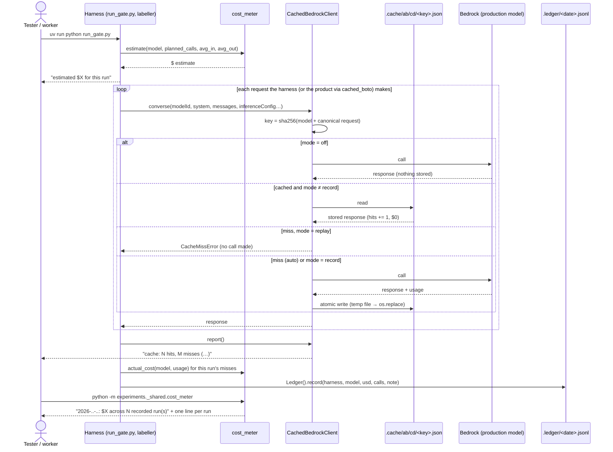
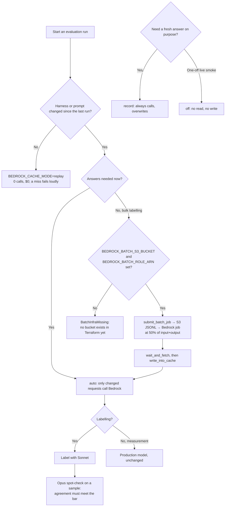
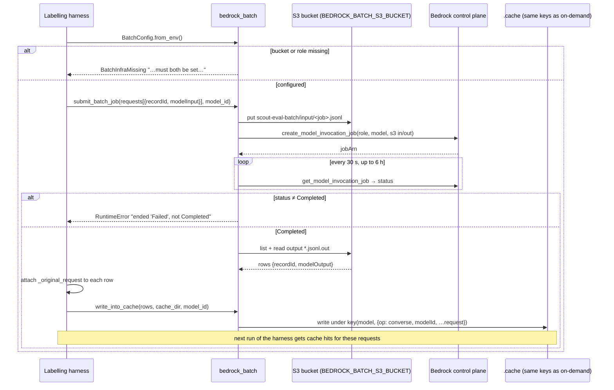

# ONLINE-7525: Shared response cache and cheaper labelling for Scout evaluation runs

**Type:** Story · Technical housekeeping (SCOUT-C)

**Objective:** Stop paying twice for the same AI request when Scout's behaviour is tested, and make every test
run's cost visible before it runs.

**Branches:** `rag` only, on `ONLINE-5385_scout_ai_integration` (2 commits tagged `ONLINE-7525`: `9d11e0d2`,
`d3c400f8`; plus `735e9bea` under ONLINE-7511, which removes that harness's workaround for the path bug `d3c400f8`
fixed). **No `swo-3.0` change**, so there is nothing to see in the product: this is tested from a terminal, not on
dev2.

---

## Ticket summary

### Principles

- Teachers see no change. Production Scout, its models and its own prompt caching are out of scope (the
  cost-and-speed ticket, ONLINE-7526, owns those).
- Every evaluation script, labeller and calibration run goes through **one** shared record-and-replay cache, keyed
  by model and the full request. An identical request is answered from disk and costs nothing.
- Measurement still uses the production models. Only **bulk labelling** moves to the cheaper model (Sonnet), with
  an Opus spot-check where agreement has to be proven.
- Bedrock batch jobs are used where answers aren't needed straight away.
- The cost is visible: an estimate before the run, the actual cost after it, and a total per day. (One day of
  testing cost about $155 with no estimate beforehand.)

### Acceptance criteria

1. Re-running an unchanged evaluation makes no new Bedrock calls.
2. All existing evaluation scripts use the cache.
3. Every run prints its estimated and actual cost, and a per-day total is kept.
4. Bulk labelling can run as batch jobs at the lower price.

---

## Where the code is

All of it is under `rag/experiments/_shared/`. Nothing here is imported by the deployed Lambda.

| Layer | File | What it does |
|---|---|---|
| **rag (shared)** | `experiments/_shared/bedrock_cache.py` | `CachedBedrockClient`: wraps a boto3 `bedrock-runtime` client's `converse` and `invoke_model`. Key = sha256 of `{"model", "request": {"op", ...all kwargs}}` with `sort_keys` (`:154`). One JSON file per key at `.cache/ab/cd/<key>.json`; the stored response keeps its `usage` block. Four modes (`:76`, env `BEDROCK_CACHE_MODE`) |
| | `experiments/_shared/cost_meter.py` | `PRICES` from the product's own `PRICE_PER_MTOK` (`lambdas/ai_assistant/src/core/config.py:32`); `estimate()` (`:65`) before a run; `actual_cost()` (`:78`) from a `usage` block; `actual_cost_from_cache()` (`:98`); `Ledger` (`:153`): one JSONL file per day in `.ledger/`, `today()` prints the day's total. `python -m experiments._shared.cost_meter` prints today |
| | `experiments/_shared/bedrock_batch.py` | `BatchConfig.from_env()` (`:59`) needs `BEDROCK_BATCH_S3_BUCKET` + `BEDROCK_BATCH_ROLE_ARN`, else raises `BatchInfraMissing`; `submit_batch_job()` (`:141`) uploads JSONL to S3 and calls `create_model_invocation_job`; `write_into_cache()` (`:117`) stores results under the same keys so a later run gets hits |
| | `experiments/_shared/check_bedrock_cache.py`, `check_cost_meter.py`, `check_bedrock_batch.py` | Offline check scripts with fake clients: 14 + 11 + 5 = **30 assertions** |
| **rag (harness adapter)** | `experiments/standards_suggest_7532/cached_boto.py` | `install()` patches `boto3.client` so the **product's own** engine calls go through the shared cache, including `converse_stream` (served from the cached `converse` of the same request, replayed as stream events) |
| **rag (harnesses)** | ~40 scripts import `_shared` (`teacher_eval/online7511`, `online7514`, `online7520`, `grading_gate_7512`, `scope_gate`, `standards_insights`, `student_insights`, `student_profiles`, `drawing_gate_7521`, `online7515`, `online7519`, `differentiation`, …) | 26 call `estimate()`, 32 call `Ledger().record()`. `teacher_eval/online7511/validate_labeller.py` is the Sonnet-labels / Opus-spot-check pattern |
| **Price table** | `lambdas/ai_assistant/src/core/config.py:32` | Sonnet 5 $2.20 / $11.00, Haiku 4.5 $1.10 / $5.50, Opus 5 $5.50 / $27.50 per M tokens in / out (Opus marked `estimated`: no billed usage yet). Batch = 50% of input + output |

### Cache modes (`BEDROCK_CACHE_MODE`)

| Mode | Reads cache | Calls Bedrock | Writes cache |
|---|---|---|---|
| `auto` (default) | yes | only on a miss | on a miss |
| `replay` | yes | **never**: a miss raises `CacheMissError` "no cached response for … in replay mode -- the request changed, or this prompt was never recorded…" | no |
| `record` | no | always | overwrites |
| `off` | no | always | no |

Any other value raises `ValueError: bad BEDROCK_CACHE_MODE …`.

### What the key includes

Everything passed to `converse` / `invoke_model`: model id, system prompt, messages, `inferenceConfig`, tool
config, guardrail config. Key order doesn't matter, and an `invoke_model` body is compared as parsed JSON, so bytes
vs. string and key order in the body don't matter either. **Anything that changes per run inside the prompt (a
timestamp, a random thread id, today's date) makes every run a miss.**

### What the user sees in a run

- Before: `estimated $X.XXXX for this run` (each harness prints it itself, using `estimate()`).
- After: `cache: N hits, M misses (R% hit rate, T lookups)` from `cached.report()`, then the actual cost.
- Per day: `YYYY-MM-DD: $X.XXXX across N recorded run(s)`, then one line per run (harness, model, $, calls, note).

---

## 1. One evaluation call through the cache (sequence)



## 2. Choosing how to run (activity)



## 3. Bulk labelling as a batch job (sequence)



---

## Test cases

**Setup:** a host checkout of `rag` on `ONLINE-5385_scout_ai_integration` with `make install-dev` done, AWS access
to Bedrock in `us-west-2` (`export AWS_PROFILE=StudiesWeekly AWS_DEFAULT_REGION=us-west-2`; botocore ignores
`AWS_REGION`). Run everything from `/home/lenovo/rag` with
`uv run --project lambdas/ai_assistant python …`. Cases 1–9 cost nothing or under $0.01 (one tiny Haiku call);
case 11 needs a real harness run, so agree the estimate before running it.

| # | Scenario | Steps | Expected |
|---|---|---|---|
| 1 | **Offline checks** | Run the three `experiments/_shared/check_*.py` scripts | `14 passed, 0 failed`, `11 passed, 0 failed`, `5 passed, 0 failed`; exit code 0 |
| 2 | **First call is recorded** | Smoke script: one `converse` to Haiku ("Reply with OK") through `CachedBedrockClient(cache_dir=<scratch>)` in `auto` | `cache: 0 hits, 1 misses`; one new file under `<scratch>/ab/cd/<key>.json` holding `op`, `model_id`, `recorded_at`, and `response.usage` |
| 3 | **Unchanged re-run makes no call (AC1)** | Run the same script again, then again with `BEDROCK_CACHE_MODE=replay` | `1 hits, 0 misses` both times; the same response text; file count unchanged. In CloudWatch / Bedrock invocation metrics, one invocation in total, not three |
| 4 | **Key ignores order, sees content** | (a) Same request with dict keys in a different order; `invoke_model` body as bytes vs. str. (b) Change one word of the prompt, or `temperature`, or the model id, in `replay` | (a) Hit. (b) `CacheMissError` "no cached response for converse '…' … in replay mode -- the request changed…", and no Bedrock call |
| 5 | **record / off / bad mode** | `BEDROCK_CACHE_MODE=record`, then `off`, then `foo` | `record`: calls Bedrock and rewrites the file (`recorded_at` changes). `off`: calls Bedrock, no file written or read. `foo`: `ValueError: bad BEDROCK_CACHE_MODE 'foo'…` before any call |
| 6 | **Corrupt entry** | Truncate the cached JSON file by hand, run in `auto` | Treated as a miss: one new call, the file is rewritten, no crash. (In `replay` it raises `CacheMissError` instead) |
| 7 | **Cache isn't committed** | `git -C /home/lenovo/rag status --short experiments/` after cases 2–6 | No `.cache/` or `.ledger/` entries show; each dir has its own `.gitignore` (`*`, `!.gitignore`) |
| 8 | **Estimate and actual cost (AC3)** | `estimate("claude-sonnet-5", 40, 1000, 200)`, then with `batch=True`; `actual_cost` of case 2's `usage` | `0.176` and `0.088`; actual cost = `in/1e6 × 1.10 + out/1e6 × 5.50` for Haiku, matching the tokens in the cached file |
| 9 | **Per-day total (AC3)** | `Ledger().record(...)` twice (two harness names), then `python -m experiments._shared.cost_meter` | `<today>: $<sum> across 2 recorded run(s)` plus one line per run; the file is `.ledger/<today>.jsonl`. A day with nothing prints `$0.0000 across 0` |
| 10 | **Batch refuses without infra (AC4)** | Unset `BEDROCK_BATCH_S3_BUCKET` / `BEDROCK_BATCH_ROLE_ARN`, call `BatchConfig.from_env()` | `BatchInfraMissing` "BEDROCK_BATCH_S3_BUCKET and BEDROCK_BATCH_ROLE_ARN must both be set…". Nothing is uploaded or submitted |
| 11 | **Real harness re-run (AC1 + AC3)** | Pick one migrated harness (e.g. `teacher_eval/online7511/validate_labeller.py`). Run it once in `auto`, then again unchanged in `replay` | Run 1 prints the estimate **before** any call, then the cache report and actual cost, and adds a ledger line. Run 2 completes with **0 misses**, $0, and the same result JSON |
| 12 | **All existing scripts use the cache (AC2)** | `grep` the harnesses that create a `bedrock-runtime` client but don't import `experiments._shared` (command below) | Expected by the AC: none. **Currently 33 files**, including labellers (see "Worth checking") |
| 13 | **Sonnet labels, Opus spot-check** | Read `validate_labeller.py` and the latest labeller runs; check the bulk label pass uses `us.anthropic.claude-sonnet-5` and only a sample goes to Opus, with the agreement bar stated | Sonnet for the bulk; Opus only on the spot-check; the bar is written before the run |
| 14 | **Batch job end to end (AC4)** | Only once a bucket and role exist: submit 2–3 Sonnet requests, `wait_and_fetch`, `write_into_cache`, then run the same requests through `CachedBedrockClient` in `replay` | Job `Completed`; replay gets hits and returns a response the harness can read; the ledger records the batch cost at 50% |
| 15 | **Teachers see no change** | `git -C /home/lenovo/rag show --stat 9d11e0d2 d3c400f8`; `grep -rn "_shared" lambdas/ai_assistant/src` | Only `experiments/` files changed; the Lambda imports nothing from `experiments/_shared` |
| 16 | **Production models unchanged** | Compare `config.py` model ids before and after the commits; in a harness, check the measured turn uses the product's model (through `cached_boto.install()`) | No production model change; only labelling uses a cheaper model |

Command for test 12:

```bash
cd /home/lenovo/rag/experiments
for f in $(grep -rlE "bedrock-runtime|ChatBedrock" --include=*.py . | grep -v _shared/); do
  grep -q "_shared" "$f" || echo "$f"
done
```

### Automated checks

```bash
cd /home/lenovo/rag
for t in experiments/_shared/check_*.py; do uv run --project lambdas/ai_assistant python "$t" || break; done
# Run 2026-09-30 during planning: 14 + 11 + 5 = 30 passed, 0 failed.

# Smoke script for test cases 1-10, 12 and 15 (this ticket's stand-in for -api-tests.sh).
# Offline by default (free); SMOKE_LIVE=1 adds 4 Haiku calls (estimate $0.000242). Writes only to a temp dir.
bash ONLINE-7525-smoke-tests.sh
export AWS_PROFILE=StudiesWeekly AWS_DEFAULT_REGION=us-west-2 SMOKE_LIVE=1 && bash ONLINE-7525-smoke-tests.sh
# Offline run 2026-10-01: PASS 10, FAIL 1 (T12: 33 scripts not on the shared cache, AC2), SKIP 1 (live).
# Live run 2026-10-01 (Haiku 4.5, us-west-2): PASS 18, FAIL 1 (T12 again). 4 real calls in total; the unchanged
# re-runs (auto and replay) and the changed requests in replay made 0. Real cost $0.000037 per call (14 in / 4 out
# tokens), about $0.00015 in all, against an estimate of $0.000242. Off-mode calls show "0 hits, 0 misses".
```

No Laravel or frontend-v3 tests apply (no change in `swo-3.0`), so there's no RefreshDatabase risk here.

---

## Local results (2026-10-01)

Local rag checkout on `ONLINE-5385_scout_ai_integration` (`35b99fba`), live Bedrock in us-west-2 through the
tester's AWS SSO session. Run with `ONLINE-7525-smoke-tests.sh` (`SMOKE_LIVE=1`). Full report:
`ONLINE-7525-test-results.docx`; the Jira comment is `jira-comment.md`.

**How it was run:** rag on `ONLINE-5385_scout_ai_integration` at `35b99fba` (ONLINE-7525 commits `9d11e0d2`,
`d3c400f8`), dependencies from `make install-dev`. AWS access confirmed with `aws sts get-caller-identity` (SSO,
us-west-2). Then `SMOKE_LIVE=1 AWS_DEFAULT_REGION=us-west-2 bash ONLINE-7525-smoke-tests.sh` from this folder: the
developer's three check scripts, then the offline checks, a printed estimate, and 4 real Haiku 4.5 calls through
the shared cache. All writes go to a temp folder deleted afterwards. Real calls are counted by a wrapper outside the
cache, so "no call" doesn't rely on the cache's own counters.

**Developer's check scripts (T1), fake Bedrock client:** 30/30. `check_bedrock_cache.py` 14 (repeat = one call;
changed message/model = new call; 16 simultaneous writers leave one valid file; replay/record/off behaviour;
`invoke_model` repeat), `check_cost_meter.py` 11 (estimates, batch half price, both usage formats, prompt-cache
rates, ledger, cost from cache files), `check_bedrock_batch.py` 5 (refuses without bucket/role; batch result read
back as a cache hit). Three prove less than their names: "off mode wrote nothing new" checks counters only;
"invoke_model … different key order" sends the same order twice; the batch read-back uses a fake result already in
`converse` format. The full per-check list is in the `.docx`.

**Summary:** smoke script 18/19 (offline 10/11, live 9/9) · 4 real Bedrock calls, about $0.00015 · **4 findings**
(AC2 not met, AC4 can't run, two cost-counting gaps).

### Status per test case

| # | Test | Status | Evidence |
|---|---|---|---|
| 1 | Offline checks | ✅ Pass | 14 + 11 + 5 passed |
| 2 | First call is recorded | ✅ Pass | 1 miss, 1 file with `op`, `model_id`, `recorded_at`, `usage` |
| 3 | Unchanged re-run makes no call (AC1) | ✅ Pass | `auto` and `replay`: 1 hit, 0 misses, 0 real calls; same answer. Counted by a wrapper, not CloudWatch |
| 4 | Key ignores order, sees content | ✅ Pass | Order: same key. Prompt / temperature / model change in replay: `CacheMissError` ×3, no call. `invoke_model` bytes vs. str covered only by the offline check |
| 5 | record / off / bad mode | ✅ Pass | `record` rewrites (`recorded_at` changed); `off` doesn't touch the cache; `foo` → `ValueError` |
| 6 | Corrupt entry | ✅ Pass | `replay` misses with no call; `auto` re-fetches and rewrites |
| 7 | Cache isn't committed | ✅ Pass | `.gitignore` written in the cache dir (checked in a temp dir, not with `git status`) |
| 8 | Estimate and actual cost (AC3) | ✅ Pass | $0.176 / $0.088; $0.000037 per call matches the tokens and `actual_cost_from_cache` |
| 9 | Per-day total (AC3) | ✅ Pass | "$0.3000 across 2 recorded run(s)" in a temp ledger; empty day $0 |
| 10 | Batch refuses without infra (AC4) | ✅ Pass | `BatchInfraMissing` with the expected message |
| 11 | Real harness re-run | Not run | Costs real money; needs a chosen script and an agreed estimate |
| 12 | All scripts use the cache (AC2) | ❌ Fail | 33 scripts call Bedrock without `experiments._shared` (finding 1) |
| 13 | Sonnet labels, Opus spot-check | Not run | |
| 14 | Batch job end to end (AC4) | Not run | Blocked: no Bedrock batch role and no batch prefix in the dev account (checked read-only with `swo-admin`, finding 2) |
| 15 | Teachers see no change | ✅ Pass | The Lambda imports nothing from `experiments/`; the commits touch only `experiments/` |
| 16 | Production models unchanged | Not run | |

### Findings

1. **33 evaluation scripts still call Bedrock without the shared cache (medium, AC2).** They include the labellers
   and calibrators listed under "Worth checking". `teacher_eval/online7507/bedrock_cache.py` is still a separate
   cache. Which of the 33 are in scope needs confirming; `results/7525-build.md` isn't in the repo.
2. **Batch jobs can't run: no S3 bucket or role (medium, AC4).** `bedrock_batch.py` refuses as designed, and no
   script submits a job. Whether batch output (native body) reads back through `converse` is unproven. A read-only
   check of the dev account with `swo-admin` (us-west-2, 2026-10-01, nothing created) found: the only bucket is
   `swo-genai-pov-…-dev-ai-export` (content-sync permissions cover `ai-export/` only); the only roles Bedrock can
   assume are `*-bedrock-cw-logging-*`, which can write CloudWatch logs but have no S3 access; Haiku 4.5 has batch
   quotas (minimum 100 records per job); **Sonnet 5 shows no batch quotas**, although the ticket wants Sonnet for
   bulk labelling; no batch job has ever run in the region. The decision was not to create a role here: it needs
   the infra owner.
3. **Batch spend would be priced at full rate (low).** `cost_meter.py:123` doesn't pass `batch=True`; batch entries
   carry `batch_record_id`, so they can be told apart.
4. **Unpriced models count as $0 (low).** `cost_meter.py:111` skips them; the product's `config.py` falls back to the
   dearest price instead.

### Observations (not failures)

- `off`-mode calls don't appear in the cache report ("0 hits, 0 misses").
- The estimate ($0.000242) was above the actual ($0.00015).
- `actual_cost_from_cache()` totals the whole cache dir, not one run.
- The ledger only holds runs whose script records them (32 do); nothing enforces a daily cap.
- Each harness has its own `.cache`, so another worktree pays again.
- Opus prices are estimated, and totals don't say so.

## Files in this folder

| File | What it is |
|---|---|
| `ONLINE-7525.md` | This document: how it works, diagrams, test plan, local results |
| `ONLINE-7525-test-results.docx` | The report to attach to Jira (11 tables, no screenshots: there's no UI) |
| `jira-comment.md` | The comment to paste, in Jira formatting |
| `ONLINE-7525-smoke-tests.sh` | Smoke checks (replaces `-api-tests.sh`): offline by default; `SMOKE_LIVE=1` adds 4 Haiku calls; optional `SMOKE_MODEL`, `RAG_DIR`, `KEEP_WORK` |
| `report_content.py` | The Word document's content; rebuild from the parent folder with `uv run --no-project --with python-docx python make_test_results_docx.py ONLINE-7525` |

## Worth checking while you test

- **AC2 isn't met yet: 33 scripts still call Bedrock without the shared cache.** Among them are labellers and
  calibrators, which the ticket names explicitly: `teacher_eval/judge.py`, `teacher_eval/online7507/label_c2.py`,
  `label_c3.py`, `label_c4.py`, `label_c5.py`, `label_pools.py`, `relabel_check.py`, `validate_label_fix.py`,
  `grading_baseline/grader.py`, `guardrail_curriculum/calib_grounding.py`. Some (the guardrail probes, `llm_latency`,
  `retrieval_eval/embed_models.py`) may be fine to leave out, since they measure latency or call other APIs; ask
  which are in scope.
- **Two per-harness caches still exist**, which the module's docstring says must be migrated ("one approach only"):
  `teacher_eval/online7507/bedrock_cache.py` (its own `cache/bedrock/` dir) and `standards_suggest_7532/cached_boto.py`
  (which does wrap the shared one, so it's an adapter rather than a second cache). The docstring's migration list,
  `results/7525-build.md`, isn't in the repo, and neither is the `PLAN.md` "Cost rules for testing" it cites.
- **Batch jobs can't run yet (AC4).** No S3 bucket or role exists for them (`bedrock_batch.py` docstring), and no
  harness calls `submit_batch_job`. AC4 is met only as far as "the code exists and refuses clearly"; the 5 batch
  checks use a fake client.
- **Batch results may be stored in the wrong shape.** Bedrock batch jobs take and return the model's native
  `InvokeModel` body (for Anthropic, `anthropic_version` / `content[]`), but `write_into_cache` stores `modelOutput`
  under a `converse` key. A harness that later calls `converse` would get a native body where it expects
  `output.message`. Confirm on the first real job (test 14).
- **Batch spend is counted at the full price.** `actual_cost_from_cache()` calls `actual_cost(alias, usage)` with no
  `batch=True` (`cost_meter.py:123`), so an entry written by a batch job is priced at on-demand rates, double the
  real cost.
- **Unpriced models are counted as $0.** `actual_cost_from_cache()` skips any model not in `PRICES`
  (`cost_meter.py:111`), for example `teacher_eval/judge.py`'s `us.openai.gpt-5.6-sol`. The product's `config.py`
  uses `FALLBACK_PRICE` (the dearest row) for exactly this reason, so spend is never under-counted.
- **"Actual cost after the run" isn't built in.** `actual_cost_from_cache()` totals the **whole** cache dir, not this
  run, so each harness works it out itself (`online7511/run_gate_v3.py` diffs the cache; `standards_suggest_7532/
  cost_since.py` filters by file time). Check each run's printed "actual" is the run's own spend.
- **The ledger is only as complete as the harnesses that call it.** Nothing records automatically; 32 scripts call
  `Ledger().record()`, but a script that doesn't is missing from the day's total. There's also no check against a
  daily cap; the docstring mentions a $10 / $30 gate, but nothing enforces it.
- **Anything per-run in a prompt defeats the cache.** A thread id with a per-run suffix (which CLAUDE.md requires
  for live Mongo), a timestamp, or "today's date" in a system prompt makes every request a miss. Test 11's `replay`
  run catches this.
- **Each worktree has its own cache.** `.cache/` sits next to each harness and is gitignored, so a second worktree
  or a colleague's checkout pays again for the same requests. That fits "per-worktree" in the code comment, but
  it's narrower than "one shared cache".
- **Opus prices are estimated** (list price × 1.1, `"estimated": True`), and that flag isn't printed with a total,
  so an Opus spot-check cost can look exact when it isn't.
