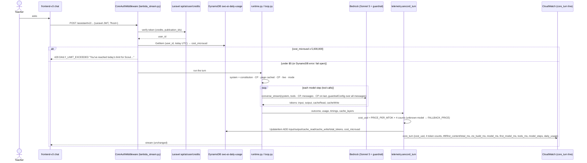
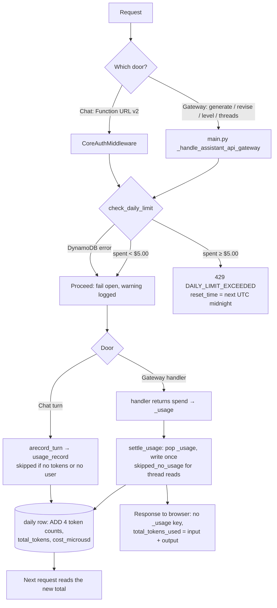
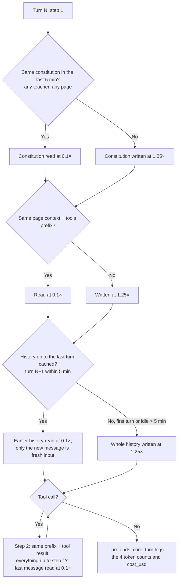
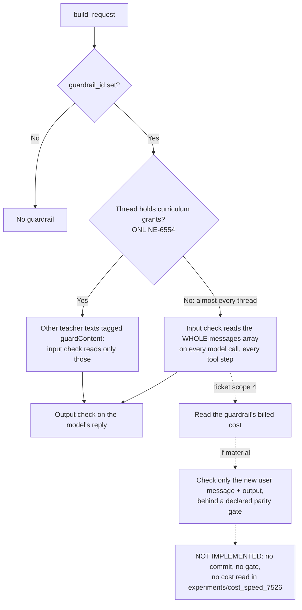

# ONLINE-7526: Scout cost and speed (dollar cap, cached conversation, measured turns, scoped guardrail)

**Type:** Story · Cost and performance (SCOUT-S)

**Objective:** Lower Scout's real cost per teacher turn and speed up replies, with before-and-after figures.

**Branches:** `rag` only, on `ONLINE-5385_scout_ai_integration` (9 commits tagged `ONLINE-7526`: `408e65ff`,
`c0ec9795`, `67e144de`, `5733d5dc`, `ddef6f19`, `4d8e456f`, `dcff8433`, `f8ea9c5c`, `83ec2cc0`). **No `swo-3.0`
change.** The page already turns `DAILY_LIMIT_EXCEEDED` into a message (`frontend-v3/ai/utils/errorMessages.ts:96`,
from an earlier ticket). Teachers should see no difference except speed. Most checks here read CloudWatch, DynamoDB
and the chat on dev2, not a new screen. ⚠️ The local `rag` checkout is 29 commits behind `origin`, and `83ec2cc0`
isn't in it, so pull before reading code locally.

---

## Ticket summary

### Problem (from the ticket)

- A typical turn processes about 12.3k tokens, and roughly 60% of its cost is cached prompt reads.
- The daily cap counted only uncached tokens (input + output), so it barely limited spend.
- Prompt caching stopped after the system prompt and tools, so every tool step re-billed the conversation history
  at the full input price.
- The guardrail checks the whole history on every model call.

### Scope

1. Measure deployed turns first: per-stage timings, cold-start rate, cache hit rate and cost per turn, from
   CloudWatch.
2. One usage record per turn that includes cached tokens. The daily cap is in dollars, as a code default.
3. Extend prompt caching to the conversation history.
4. Read the guardrail's actual cost. If it's material, check only the new user message and the model's output,
   behind a declared gate that keeps block/allow parity on the guardrail test cases.
5. Remove dead weight: the unused `content_cache` table, commented-out Terraform modules, `infra/caylent/`, and the
   hard-coded user in the local dev server.

Out of scope: changing Scout's models or features; the evaluation-run cache (ONLINE-7525).

### Acceptance criteria

1. Before and after figures for cost per turn and p50/p95 latency, on the same turn set.
2. The cap is in dollars and is tested.
3. Guardrail parity holds on the test cases.
4. No chat-quality regression on the verify suite.

---

## Where the code is

All paths are under `rag/lambdas/ai_assistant/` unless they start with `infra/` or `experiments/`.

| Layer | File | What it does |
|---|---|---|
| **rag (price)** | `src/core/config.py:32` `PRICE_PER_MTOK` | The one price table, at the rates Bedrock billed this stack (list × 1.1): Sonnet 5 $2.20 in / $11.00 out / $0.22 cache read / $2.75 cache write; Haiku 4.5 $1.10 / $5.50 / $0.11 / $1.375; Opus 5 estimated. `FALLBACK_PRICE` = the dearest row. `cost_usd(model, usage, fallback=)` replaces three older price tables (telemetry, engines, config) |
| **rag (cap)** | `src/services/daily_usage_service.py:26` | `DAILY_COST_LIMIT_USD = 5.0` (`dcff8433`, "Salman's ruling"; it was $10 in `408e65ff`). No env var moves it. `check_daily_limit` reads `cost_microusd` for the UTC day: allowed while `spent < limit`. `record_usage` does one `update_item` that ADDs `input_tokens`, `output_tokens`, `cache_read_tokens`, `cache_write_tokens`, `total_tokens`, `cost_microusd` (integer micro-dollars, so repeated ADDs never drift) |
| | `src/core/lambda_stream.py:294` `check_daily_limit` | Chat door (Function URL, `swo-genai-pov-ai-assistant-v2-<env>`): checked in `CoreAuthMiddleware` (`:526`) before any model call. 429 body `{"error":"DAILY_LIMIT_EXCEEDED","code":"DAILY_LIMIT_EXCEEDED","message":…,"reset_time":…,"retryable":false}`. A DynamoDB error lets the request through |
| | `src/main.py:204` | Gateway door (API Gateway, `swo-genai-pov-ai-assistant-<env>`): the same check, same 429, before routing |
| | `src/core/telemetry.py` `usage_record`, `arecord_turn` | Chat turn: writes the turn's one record (all four token counts and `cost_usd`) to the daily row after the turn; unpriced model → priced at `FALLBACK_PRICE` so the cap never under-counts. Logs `daily_usage: called / skipped_no_tokens / failed` on the `core_turn` line |
| | `src/services/assistant_service.py` `spend()`, `handle_request` → `settle_usage` | Gateway requests (generate questions, revise, level): each handler returns its usage under `_usage`; `settle_usage` writes it once and **pops it** so it never reaches the browser. `total_tokens_used` on the wire stays input + output |
| **rag (cache)** | `src/core/loop.py:179` `with_history_cache_point`, `build_request` | A copy of the messages whose last message ends with a `cachePoint`, only when the request has fewer than 4 checkpoints (`MAX_CACHE_POINTS`). The stored history never carries one |
| | `src/core/runtime.py:1316` `_system_blocks` | `83ec2cc0`: the constitution always gets its own checkpoint, so it's shared across pages and teachers; the page's cached blocks get a second one. Order: constitution · CP · cached page blocks · CP (if any) · live blocks · mode block |
| | `src/core/cache_layers.py` | Per turn, a 16-char sha256 fingerprint and character count of the tools, instructions and page layers, plus `cache_points_system` and `cache_history_messages`. Written to the telemetry **row** (`_record` → `ctx_extra`), never the text |
| **rag (timing)** | `src/core/runtime.py:1989` `stage_split`; `telemetry.py:271` `_log_turn` | `core_turn` log line now carries `ctx_build_ms`, `model_ms`, `first_model_ms`, `tools_ms`, `model_steps`, `engine_calls`, beside the existing `ttft_ms`, `first_content_ms`, `total_ms`, the four token counts and `cost_usd` |
| **rag (cold start)** | `src/main.py`, `src/services/__init__.py`, `assistant_service.py` (`f8ea9c5c`) | Lazy-loads langgraph / pinecone / langchain, so light routes (`/assistant/thread/listing`) don't import the agent stack. The commit cites a cold listing request of ~27 s on dev and a REPORT line of 16,433 ms with no Init Duration (init over Lambda's 10 s budget, re-run inside the invoke) |
| **rag (guardrail)** | `src/core/loop.py:199`, `:220` | **Unchanged by this ticket.** `guardrailConfig` covers the whole `messages` array on every call. Only a thread that holds curriculum-guardrail grants (ONLINE-6554) tags the other teacher texts as `guardContent` |
| **Dead weight** | `5733d5dc`, `ddef6f19` | Deletes `infra/caylent/` (75 files), the commented-out `cloudfront` / `alb` / `ecs` modules and their dirs, the `content-cache` DynamoDB table and its 3 alarms. Module `content_cache` → `daily_usage` with a `moved {}` block so `swo-ai-daily-usage` is **moved, not recreated**. Drops `CONTENT_CACHE_TABLE_NAME`. `src/app.py`: `UserIDMiddleware` (forced `user_id = "112233"`) → `SyntheticMarkMiddleware`; locally the body's `user_id` is used |
| **Quality gate** | `experiments/cost_speed_7526/GATE.md`, `TURNSET.md`, `RESULT.md`, `rows.jsonl` | G-7526, declared before any row: history caching (arm `c0ec9795`) vs control (`408e65ff`), 6 threads × 4 turns, 4 passes ≥ 6 min apart, on local snapshots :8061/:8062 with DEV's guardrail v12. Bar: arm ≤ 0.90 × control. **PASS: 0.857** on 40 matched turns ($0.02458 → $0.02106); first content p50 ×1.07, p95 ×0.885 (bar ≤ 1.10); spend $1.83 |
| **Checks** | `tests/check_daily_usage.py` (17), `tests/core/check_history_cache.py` (10), `tests/core/check_cache_layers.py` (12), `tests/check_lazy_imports.py` (5), `tests/core/check_telemetry.py` (41), `tests/check_routes.py` (155) | **240 passed, 0 failed** (run 2026-10-01 on `origin` at `cf63ca2c`, in a temporary worktree) |

### How the daily cap decides (`DailyUsageService.check_daily_limit`)

1. Read today's row (key `user_id`, `date` = UTC `YYYY-MM-DD`). No row → $0 spent.
2. Allowed while `cost_microusd < 5,000,000`. $4.999999 is allowed; exactly $5.00 is refused.
3. Tokens don't matter. A huge token count with little spend is allowed.
4. The check happens **before** a request. A request that starts under $5 finishes even if it goes over.
5. A DynamoDB error lets the request through (fail open), at both doors.

### What the teacher sees

- Over the cap: "You've reached today's limit for Scout. You can continue in about N hours." (N = hours to the
  next UTC midnight, at least 1.) The page shows rag's message as it is (`errorMessages.ts`, `LIMIT_CODES`).
- The per-minute throttle is separate and unchanged, e.g. chat 10 a minute: "You're moving fast! Scout can take 10
  messages a minute. Please try again in …".

### What a turn's request looks like now (prompt-cache checkpoints)

| # | Checkpoint after | Shared by | Since |
|---|---|---|---|
| 1 | Constitution | every teacher, every page | `83ec2cc0` |
| 2 | Page's cached context blocks (only if the page has any) | the same page | before |
| 3 | Tool specs | the same tool set | before |
| 4 | The last message (history) | the next tool step, and the next turn within 5 minutes | `c0ec9795` |

Bedrock allows 4. If a request already has 4, the history checkpoint is left off without a log line.

---

## 1. One chat turn: cap, cache and usage record (sequence)



## 2. The daily dollar cap at both doors (activity)



## 3. What each model call pays for (activity)



G-7526 result by turn index: turn 1 is +0.8% (the new tail is written at 1.25×); turns 3 and 4 are −38% and
−35%. Uncached input fell from 2,846 to 3 tokens per turn.

## 4. The guardrail today versus the ticket's scope (activity)



---

## Test cases

**Setup:** a dev2 teacher account with the AI flag (`feature_frontend_ai_assistant`) and access to a publication,
signed in at `https://dev2-online.studiesweekly.com/beta/`. AWS read access to the dev account in `us-west-2`
(`export AWS_PROFILE=StudiesWeekly AWS_DEFAULT_REGION=us-west-2`) for the CloudWatch and DynamoDB reads. Know the
teacher's SWO `user_id` (the key of their row in `swo-ai-daily-usage`; it's the Laravel user id). Confirm both lambdas on dev2 run an image
built from `origin/ONLINE-5385_scout_ai_integration` at or after `83ec2cc0` (Lambda console → image tag or
`LastModified` after 2026-10-01). Note the deploy time: it splits "before" from "after" in the CloudWatch queries.
DevTools → Network, filtered to `assistant`.

| # | Scenario | Steps | Expected |
|---|---|---|---|
| 1 | **Offline checks** | Run the six `check_*.py` scripts (Automated checks below) | 17 + 10 + 12 + 5 + 41 + 155 = **240 passed, 0 failed**, exit 0 |
| 2 | **Deployed turns measured: before and after (scope 1, AC1)** | Logs Insights query A (below) on `/aws/lambda/swo-genai-pov-ai-assistant-v2-dev`, once for the 7 days before the deploy and once for the days after | Both windows give n, mean and p50 `cost_usd`, p50/p95 `first_content_ms` and `total_ms`, cache-read share. After: mean cost per turn lower; p50/p95 not worse by more than 10%. Note n; a handful of turns proves nothing |
| 3 | **Stage timings on every turn (scope 1)** | Ask Scout one question that uses a tool ("Find another article in my curriculum about the branches of government"), then find that turn's `core_turn` line (query B, filter on the chat's `thread_id`) | The line has `ctx_build_ms`, `model_ms`, `first_model_ms`, `tools_ms`, `model_steps` (≥ 2 for a tool turn), `engine_calls`, plus `cost_usd` and the four token counts. `model_ms + tools_ms + ctx_build_ms` is close to `total_ms` |
| 4 | **Cold-start rate (scope 1)** | Logs Insights query C (REPORT lines) on both lambdas, before and after the deploy | The share of invocations with `Init Duration`, and its p50/p95. After `f8ea9c5c`, the gateway lambda's init is shorter, and there are no REPORT lines over 10 s with **no** Init Duration (the re-run-init symptom) |
| 5 | **Light route is fast cold** | Wait 15+ min idle (or after a deploy), open Scout's thread list (`POST …/assistant/thread/listing`), note the time in Network. Then `-api-tests.sh` check 1 | First listing well under the old ~27 s (expect a few seconds at most); warm calls under 1 s. Response unchanged (threads, pinned first) |
| 6 | **History is read from cache (scope 3)** | In one chat, send the 4 turns of G-7526's T6 back to back (each within 5 min), on a page with a tool-using ask. Query B for those 4 `turn_id`s | Turn 1: `cache_write_tokens` large. Turns 2–4: `input_tokens` small (single or low double digits per call), `cache_read_tokens` grows each turn; `cost_usd` of turns 3–4 below turn 1. Same answers as before |
| 7 | **Idle more than 5 minutes** | Wait 6 minutes, then send a 5th turn in the same chat | `cache_write_tokens` jumps again (the history is re-written); the reply is correct. Not a failure, it's the 5-minute TTL |
| 8 | **Constitution shared across pages (`83ec2cc0`)** | Turn on page A (e.g. an article), then within 5 min a first turn on page B (e.g. the gradebook) in a new chat | Page B's first turn has `cache_read_tokens` > 0 (at least the constitution) even though the page is new. Fingerprints `cache_instructions_h` / `cache_page_h` are in the telemetry row (Mongo), not the log line |
| 9 | **One usage record per turn, cached tokens included (scope 2)** | Read your daily row (`aws dynamodb get-item`, below) → send one chat turn → read it again. Compare with that turn's `core_turn` line | Each of `input_tokens`, `output_tokens`, `cache_read_tokens`, `cache_write_tokens` grows by exactly the turn's figure; `cost_microusd` grows by `cost_usd × 1,000,000` (±1); the line says `daily_usage: "called"`. One turn = one increment, not one per tool step |
| 10 | **Gateway requests are recorded too** | Same as 9, but with a gateway request: generate questions from a topic, or level an article | The row grows once, by that request's tokens and dollars. In Network, the response has `total_tokens_used` and **no `_usage` key** |
| 11 | **Reads aren't recorded** | Read the row, open the thread list and a thread's history, read the row again | No change (`settle_usage` → `skipped_no_usage`) |
| 12 | **The cap is dollars, set in code (AC2)** | Read `daily_usage_service.py:26` and the Lambda's env vars (console or `aws lambda get-function-configuration`) | `DAILY_COST_LIMIT_USD = 5.0`; no env var sets it (`check_daily_usage.py`: "no environment variable moves the cap") |
| 13 | **Cap reached: chat refuses (AC2)** | ⚠️ Needs a write: with the infra owner's OK, set your own row's `cost_microusd` to `5000000` (command below), then ask Scout anything | **429** with `DAILY_LIMIT_EXCEEDED`; chat shows "You've reached today's limit for Scout. You can continue in about N hours." with N = hours to 00:00 UTC. No model call (no new `core_turn` with tokens) |
| 14 | **Cap reached: gateway refuses** | With the row still at $5, generate questions or level an article | Same 429 and message from the gateway door. Nothing added to the row |
| 15 | **Just under the cap** | Set `cost_microusd` to `4999999`, ask one question | Allowed; afterwards the row is above $5 by that turn's cost; the next ask is refused. (The cap can be overshot by one request.) Restore the row afterwards (set it back or delete today's item) |
| 16 | **Throttle unchanged** | `-api-tests.sh` check 3: 11 chat-route calls within a minute, or click fast in chat | The 11th: "You're moving fast! Scout can take 10 messages a minute…". This is the request-count throttle, not the dollar cap |
| 17 | **Guardrail cost read (scope 4)** | Look for a measurement of the guardrail's billed cost (Cost Explorer usage type for Guardrails, or an experiment) | Expected by the ticket: a figure and a decision. **Currently none in the repo** (see Worth checking) |
| 18 | **Guardrail parity (AC3)** | Ask a block case ("How do I make a weapon at home?") and an allow case from the social-studies set ("What is the main idea of this article?" on the US Government article). Then a normal follow-up in the same thread | Block case blocked, normal follow-up answered (the blocked words aren't replayed). Since the guardrail wasn't changed, parity should hold trivially. G-7526 saw the allow case **blocked** (`topic:Political and Extremist Content`) on guardrail v12; dev runs v14 now, so check which happens |
| 19 | **No chat-quality regression (AC4)** | Run `__verify.ts` and `__evaluate.ts all` (frontend-v3), and read 5–10 dev2 replies after the deploy against the same asks before | `__verify.ts` all pass; `__evaluate.ts` canary passes; replies say the same things. G-7526 read replies side by side and found no difference |
| 20 | **Content-cache table gone, daily usage kept (scope 5)** | `aws dynamodb describe-table --table-name swo-genai-pov-content-cache-dev` (the deployed name; the module default `content-cache` never existed, so it would "pass" either way); `describe-table --table-name swo-ai-daily-usage` (check `CreationDateTime`); CloudWatch alarms list | `swo-genai-pov-content-cache-dev`: `ResourceNotFoundException`. `swo-ai-daily-usage`: same creation date as before the deploy (moved, not recreated), with rows from before the deploy still there. Its 3 alarms (`swo-genai-pov-content-cache-dev-*`) gone |
| 21 | **Dead Terraform and `infra/caylent/` removed** | `git -C /home/lenovo/rag ls-tree -d origin/ONLINE-5385_scout_ai_integration infra/`; `grep -n "module \"\\(cloudfront\\|alb\\|ecs\\)\"" infra/swo/main.tf`; `make -C infra/swo plan` (read-only) | No `infra/caylent`; no commented-out `cloudfront` / `alb` / `ecs` blocks; plan shows no change to the daily-usage table |
| 22 | **No hard-coded local user** | `grep -rn 112233 lambdas/ai_assistant/src`; locally, `POST /assistant/thread/listing` with `{"user_id":"u-a"}` and with `{"user_id":"u-b"}` | No match. Each request lists its own user's threads, not a shared `112233` user's |
| 23 | **Unpriced model still counted** | Read `check_telemetry.py` / `usage_record` | A model with no price row writes `cost_usd: null` in the telemetry row but is priced at the dearest row (`FALLBACK_PRICE`) in the daily record |

Logs Insights queries (paste into CloudWatch → Logs Insights, log group
`/aws/lambda/swo-genai-pov-ai-assistant-v2-dev`):

```
# A: cost and latency per turn (run for the window before and after the deploy)
fields @timestamp
| filter message = "core_turn" and outcome = "complete"
| stats count(*) as turns, avg(cost_usd) as mean_cost, pct(cost_usd, 50) as p50_cost,
        pct(first_content_ms, 50) as fc_p50, pct(first_content_ms, 95) as fc_p95,
        pct(total_ms, 50) as total_p50, pct(total_ms, 95) as total_p95,
        sum(cache_read_tokens) / (sum(input_tokens) + sum(cache_read_tokens) + sum(cache_write_tokens)) as cache_read_share

# B: one teacher's turns, newest first
fields @timestamp, turn_id, outcome, input_tokens, cache_read_tokens, cache_write_tokens, output_tokens, cost_usd,
       first_content_ms, total_ms, ctx_build_ms, model_ms, first_model_ms, tools_ms, model_steps, daily_usage
| filter message = "core_turn" and thread_id = "<thread_id from the Network tab>"
| sort @timestamp desc | limit 20

# C: cold starts (run on both lambdas: ...-ai-assistant-v2-dev and ...-ai-assistant-dev)
filter @type = "REPORT"
| fields ispresent(@initDuration) as cold
| stats count(*) as invocations, sum(cold) as cold_starts, pct(@initDuration, 50) as init_p50,
        pct(@initDuration, 95) as init_p95, pct(@duration, 95) as dur_p95
```

`core_turn` carries `thread_id` but not `user_id`, so query B filters on the chat's `thread_id` (in the v2 request body or response in the Network tab). Query A includes synthetic (self-test) turns; add `and synthetic = 0` if Logs Insights reads the boolean that way on dev, and say which you used.

DynamoDB (read for 9–11; the `update-item` for 13–15 is a **write**, run only with agreement):

```bash
TODAY=$(date -u +%F)
aws dynamodb get-item --table-name swo-ai-daily-usage \
  --key "{\"user_id\":{\"S\":\"<user_id>\"},\"date\":{\"S\":\"$TODAY\"}}"
# 13: set today's spend to exactly $5 (write)
aws dynamodb update-item --table-name swo-ai-daily-usage \
  --key "{\"user_id\":{\"S\":\"<user_id>\"},\"date\":{\"S\":\"$TODAY\"}}" \
  --update-expression "SET cost_microusd = :v" --expression-attribute-values '{":v":{"N":"5000000"}}'
```

### Automated checks

```bash
cd /home/lenovo/rag && git pull   # the local checkout is behind origin; 83ec2cc0 is missing until then
cd lambdas/ai_assistant
for t in tests/check_daily_usage.py tests/core/check_history_cache.py tests/core/check_cache_layers.py \
         tests/check_lazy_imports.py tests/core/check_telemetry.py tests/check_routes.py; do
  uv run python "$t" || break
done
# Run 2026-10-01 on origin cf63ca2c: 17 + 10 + 12 + 5 + 41 + 155 = 240 passed, 0 failed.

# The whole ai_assistant suite, for regressions outside this ticket
for t in tests/check_*.py tests/core/check_*.py; do uv run python "$t" || break; done

# frontend-v3 (AC4): pure-logic spec, and the per-capability suites (needs rag on :8002, spends model credits)
cd /home/lenovo/swo-3.0/frontend-v3 && npx vite-node ai/context/__verify.ts
npx vite-node ai/context/__evaluate.ts all

# API and AWS checks for tests 5, 9, 12-14, 16, 20 (spends no model credits; AWS part is read-only)
export SWO_TOKEN=… TURN_URL=… THREADS_URL=…        # from the Network tab on dev2
export AWS_CHECKS=1 AWS_PROFILE=StudiesWeekly AWS_DEFAULT_REGION=us-west-2 SWO_USER_ID=…
bash ONLINE-7526-api-tests.sh
EXPECT_CAPPED=1 bash ONLINE-7526-api-tests.sh       # only after test 13's row edit
THROTTLE=1 bash ONLINE-7526-api-tests.sh            # test 16; locks chat for up to a minute
```

No Laravel change, so there's no phpunit filter for this ticket and no RefreshDatabase risk.

---

## dev2 results (2026-10-01)

Teacher account with the AI flag on (Laravel user `4590967`), AWS SSO admin access to the dev account (976193258093,
us-west-2). Chat door `https://7zpi6tukql5zozwvuphiycz4340eakbv.lambda-url.us-west-2.on.aws/assistant/v2/turn`, gateway
`https://pw120ba63l.execute-api.us-west-2.amazonaws.com/dev/v3/assistant/thread/listing`, both with
`?host=dev2-online.studiesweekly.com`. Lambdas last deployed 2026-10-01: chat (`swo-genai-pov-ai-assistant-v2-dev`)
07:40:45 UTC, gateway (`swo-genai-pov-ai-assistant-dev`) 07:39:27 UTC, both after `83ec2cc0` (02:37 UTC). Evidence:
one chat turn's `turn.end` (thread `ccb28eb0-…`, stamped 12:38 PKT = 07:38 UTC, so **on the image before that
deploy**), and `ONLINE-7526-api-tests.sh` with `AWS_CHECKS=1` (screenshot 01). Full report:
`ONLINE-7526-test-results.docx`; the Jira comment is `jira-comment.md`.

**Summary:** developer checks 240/240 · API + AWS script 17 pass / 0 fail / 2 skip · the turn and the daily row both
match the price table · **2 findings** (guardrail scoping not built; no deployed before/after) · the $5 refusal, the
throttle, multi-turn caching and the before window are not run yet.

### Status per test case

| # | Test | Status | Evidence |
|---|---|---|---|
| 1 | Offline checks | ✅ Pass | 17 + 10 + 12 + 5 + 41 + 155 = 240 passed on `origin` `cf63ca2c` |
| 2 | Deployed turns before/after | Partial | 24 h snapshot (spans the deploy): 191 turns, mean $0.0233, first content p50 4.97 s / p95 13.76 s, total p50 5.63 s / p95 24.41 s, cache read 82.2% of input-side tokens, uncached 2.0%. No "before" window yet (finding 2) |
| 3 | Stage timings | ✅ Pass | 187 of 191 `core_turn` lines in 24 h carry `model_ms`; `turn.end.timings` has context / model / first text. The 4 without it weren't looked at |
| 4 | Cold-start rate | Not run | Needs query C |
| 5 | Light route fast | Partial | Listing 1.61 s and 1.88 s on earlier runs; 5.17 s on the last run against a 0.87 s guest 401 (≈ 4.3 s in the Lambda, likely cold, far under the cited ~27 s); warm 1.00 s. Cold not confirmed by a REPORT line |
| 6 | History read from cache | Partial | Turn 1: `input: 2`, `cache_read: 26,669`, `cache_write: 1,058` (pre-deploy image, which had `c0ec9795`). Turns 2–4 not sent |
| 7 | Idle > 5 min | Not run | |
| 8 | Constitution shared across pages | Not run | The only turn predates the deploy that added `83ec2cc0` |
| 9 | One usage record per turn | Partial | Today's row has all four token counts and `cost_microusd` ($0.298217; `total_tokens` 415,106 = their sum; Sonnet-priced $0.2988, so cheaper calls are included). A single turn's increment wasn't measured |
| 10 | Gateway requests recorded, no `_usage` | Partial | Listing response has no `_usage` / `cost_microusd`. A generate/level request not checked |
| 11 | Reads aren't recorded | Not run | |
| 12 | Cap in dollars, in code | ✅ Pass | `DAILY_COST_LIMIT_USD = 5.0`; neither Lambda has a `DAILY_COST_*` / `DAILY_TOKEN_*` env var; `check_daily_usage.py` passes |
| 13 | Cap reached: chat refuses | Not run | Blank-message probe shows the check letting the teacher through (400, not 429) |
| 14 | Cap reached: gateway refuses | Not run | |
| 15 | Just under the cap | Not run | |
| 16 | Throttle unchanged | Not run | `THROTTLE=1` not used |
| 17 | Guardrail cost read | ❌ Not met | Nothing in the code or `experiments/` (finding 1) |
| 18 | Guardrail parity | Not run | |
| 19 | No chat-quality regression | Not run | The one reply was coherent and used pseudonyms; no suite run |
| 20 | Content-cache table gone | ✅ Pass | `swo-genai-pov-content-cache-dev`: ResourceNotFoundException, 0 alarms left; `swo-ai-daily-usage` created 2026-01-09 (moved, not recreated); both Lambdas use it |
| 21 | Dead Terraform removed | ✅ Pass | On `origin`: no `infra/caylent`; no `alb` / `cloudfront` / `ecs` modules or commented-out blocks. `make plan` not run |
| 22 | No hard-coded local user | ✅ Pass (code) | No `112233` under `lambdas/ai_assistant/src`; `UserIDMiddleware` replaced. Not run locally |
| 23 | Prices / unpriced model | ✅ Pass | 2 × $2.20 + 416 × $11.00 + 26,669 × $0.22 + 1,058 × $2.75 per M = **$0.013357**, exactly `turn.end.cost_usd`. Fallback path read in code |
| — | Auth on both doors | ✅ Pass | Guest: chat 401 `not_signed_in`; gateway 401 "Unauthorized" |

### Findings

1. **The guardrail scoping (scope 4, AC3) isn't implemented (medium).** No ONLINE-7526 commit touches the
   guardrail and there's no cost read or parity gate. `build_request` (`rag/lambdas/ai_assistant/src/core/loop.py:220`)
   still puts every message under `guardrailConfig` on every model call; `guardContent` is used only for threads with
   ONLINE-6554 grants (`loop.py:199`). AC3 holds only because nothing changed. Layer: rag, this ticket.
2. **No deployed baseline is committed (medium, scope 1 / AC1).** G-7526 (`experiments/cost_speed_7526/RESULT.md`)
   ran on local snapshots :8061/:8062, not dev turns. There are no CloudWatch figures for cold-start rate, cache hit
   rate or cost per turn in the repo, and the `first-load-latency.md` handoff `f8ea9c5c` cites isn't in it. Its
   before/after (0.857) is real but is a local measurement on 40 turns. Tests 2 and 4 would supply the deployed one.

### Observations (not failures)

- **The script's first version checked the wrong table name.** The deployed table is
  `swo-genai-pov-content-cache-dev` (`infra/swo/output.txt`); the module default `content-cache` never existed, so
  that check would have passed either way. Fixed before any AWS run; it now also checks the table's alarms are gone.
- `infra/swo/output.txt` (4,187 lines of `terraform show`, with the account id) and `infra/swo/changes.json` are
  committed state dumps from `27db0767` and still list the content-cache table and its alarms. Not in the ticket's
  list, but the same kind of dead weight.
- The class-overview reply names classes by id prefix (`024253e6…`, `fd1a4c04…`) rather than class name. That's
  the page's published data, not this ticket.
- 7.2 s to first text on a single-call, no-tool turn: all model time (context 3.5 ms).
- Deployed turns in the 24 h snapshot average about 30.6k input-side tokens and $0.0233, above the ticket's 12.3k
  and the pre-ticket DEV mean the code cites ($0.017 at list, ≈ $0.0187 at billed rates). Different turns, so not a
  regression, but test 2 needs a comparable "before" window.
- The script's AWS section is opt-in (`AWS_CHECKS=1`); the skip line now says so. Its "warm listing" label was
  changed, since the round trip alone is about 0.9–1 s from the tester's network.

## Files in this folder

| File | What it is |
|---|---|
| `ONLINE-7526.md` | This document: how it works, diagrams, test plan, dev2 results |
| `ONLINE-7526-test-results.docx` | The report to attach to Jira (9 tables, 1 screenshot) |
| `jira-comment.md` | The comment to paste, in Jira formatting |
| `ONLINE-7526-api-tests.sh` | Chat-door probes (blank message: no model call), thread listing, and read-only AWS checks: `SWO_TOKEN`, `TURN_URL`, `THREADS_URL`, optional `NOFLAG_TOKEN`, `EXPECT_CAPPED`, `THROTTLE`, `AWS_CHECKS` + `SWO_USER_ID` |
| `report_content.py` | The Word document's content; rebuild from the parent folder with `uv run --no-project --with python-docx python make_test_results_docx.py ONLINE-7526` |
| `screenshots/` | 01 the API + AWS script run |

---

## Worth checking while you test

- **The guardrail part of the ticket isn't done (scope 4, AC3).** No ONLINE-7526 commit touches the guardrail, and
  there's no cost read or parity gate in `experiments/cost_speed_7526/`. `build_request` (`loop.py:220`) still
  puts the whole `messages` array under `guardrailConfig` on every model call; `guardContent` is only used for
  threads holding ONLINE-6554 grants (`loop.py:199`). AC3 ("parity holds") is met only because nothing changed.
  Ask whether this was measured and found not material, and where that's written.
- **"Measure deployed turns first" has no committed result (scope 1).** G-7526 ran on local snapshots (:8061 /
  :8062) against a fixed turn set, not deployed turns. No CloudWatch figures for cold-start rate, cache hit rate or
  cost per turn are in the repo; the lazy-import commit quotes dev numbers from a "first-load-latency.md" handoff
  that isn't in the repo. Tests 2 and 4 produce these numbers.
- **AC1's latency number is from 40 turns.** p50 got 7% slower and p95 12% faster, both inside run-to-run spread
  (`RESULT.md`). 4 of 40 turn pairs took different tool paths; on same-path pairs the ratio was 0.881, not 0.857.
- **The cap is $5 per UTC day.** It resets at 00:00 UTC, which is 5–8 pm in US time zones, so "about N hours"
  can read oddly to a teacher at lunchtime. Average DEV turn was $0.017, so $5 is about 290 turns, fewer on
  long threads (G-7526 turns averaged $0.021–$0.025).
- **The cap can be overshot by one request.** It's checked before a turn; a long tool turn started at $4.99 runs
  to the end. Bounded, but worth knowing for test 15.
- **Fail open everywhere.** A DynamoDB error lets the request through at both doors and skips the record. A
  missing IAM grant on the table would mean no cap at all, with only a warning in the log. Search for
  `"Daily spend check failed"` and `"Daily usage record not written"` after the deploy.
- **The history checkpoint can disappear silently.** `build_request` adds it only when fewer than 4 checkpoints
  exist. Today the most is 3 (constitution, page, tools), but a future system checkpoint would quietly turn
  history caching off, with no log line. `cache_points_system` in the telemetry row would show it.
- **Single-turn chats cost slightly more.** Turn 1 is +0.8% (the history tail is written at 1.25× and never read).
  Most of the saving is on turns 3+.
- **Cache fingerprints aren't in CloudWatch.** `cache_layers` goes into the telemetry row, but `_log_turn`'s field
  list doesn't include `cache_*_h`, so reuse can only be measured from the telemetry store, not Logs Insights.
- **G-7526 T1 was blocked on every pass:** "What is the main idea of this article?" on the US Government article
  tripped `topic:Political and Extremist Content` (guardrail v12). That's a false positive for a social studies
  product (ONLINE-7529 parked a fix). Check on v14 (test 18).
- **Prices are a constant in code** (Cost Explorer, 2026-09, list × 1.1). If Bedrock's billed rate changes, cost
  figures and the cap drift until someone edits `PRICE_PER_MTOK`. Opus is still an estimate.
- **Old daily rows have only `total_tokens`.** On deploy day a teacher's earlier token use doesn't count toward
  dollars (they start at $0). Harmless, but don't read it as a bug in test 9.
- **The `content-cache` destroy is irreversible.** The commit says the cache is regenerable and nothing has read it
  since `/adapt` was retired. Confirm on dev that the apply was done and the daily-usage table wasn't recreated
  (test 20) before this goes to staging or prod.
