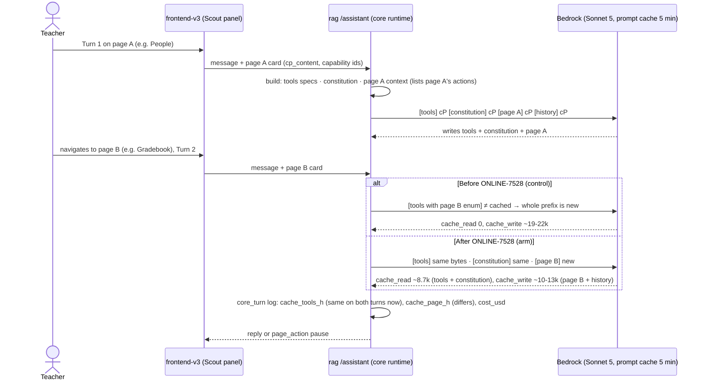
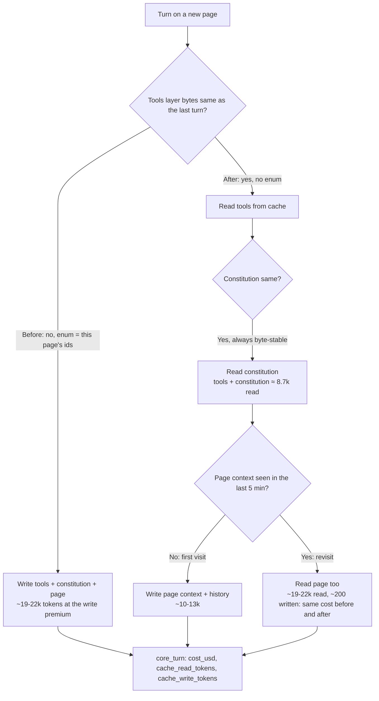
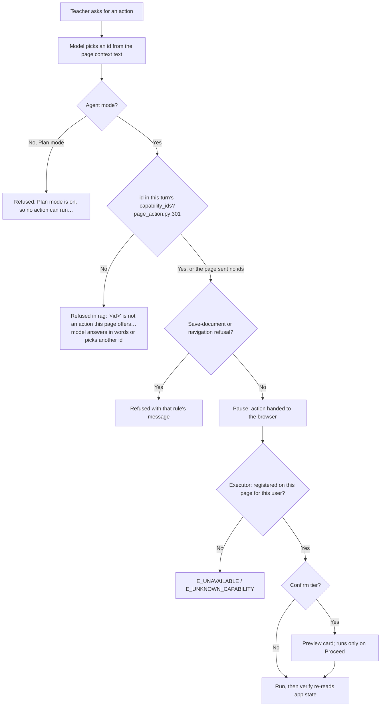

# ONLINE-7528: Page switches stop re-paying Scout's cached prompt

**Type:** Story · Cost and performance (SCOUT-P, follow-up to ONLINE-7526)

**Objective:** Lower Scout's cost when a teacher moves between pages, with no change to what Scout can do on each
page.

**Branches:** `rag` only, on `ONLINE-5385_scout_ai_integration` (4 commits tagged `ONLINE-7528`: one code change,
`00e330ce`, and three gate commits). No `swo-3.0` commit: the frontend, the executor and Laravel are unchanged.

---

## Ticket summary

### Problem and scope

- The list of actions the current page offers sat inside a tool definition (`page_action`'s `capability` argument
  carried a per-page `enum`). Tool definitions are part of the cached prompt prefix, so every page switch rewrote
  about 9,000 cached tokens. After ONLINE-7526, writing the cache is about 63% of Scout's spend.
- **In scope:** move the page's action list out of the tool definition and into the page context message, so the
  tool definitions stay the same on every page. The executor's permission checks stay the authority on what can
  run (unchanged).
- **Out of scope:** adding or removing page actions; the daily cap and history caching (ONLINE-7526).
- **Teachers see no change.** Scout picks the same actions on each page.

### Acceptance criteria

(Locked before running; arm against control on the same turn set.)

1. Cost per turn on turns that follow a page switch falls by **at least 20%**.
2. Action-choice accuracy on a fixed set of page-action requests is **no worse than the control**.
3. **No action runs that the page does not offer** (0 cases).
4. Scout's verify suite and the rag checks stay green.

---

## Where the code is

| Layer | File | What it does |
|---|---|---|
| **rag** | `lambdas/ai_assistant/src/core/tools/page_action.py:41` `_spec()` | **The change.** `capability` is now a plain string ("A capability id exactly as the page context lists it"), with no `enum`. The `spec_for(ctx)` override that built a per-page schema is removed, so `page_action.spec` is one object for every page |
| | `src/core/tools/page_action.py:292` `run()` | Unchanged. Refuses in Plan mode, then refuses an id that isn't in this turn's `ctx.capability_ids`: "'<id>' is not an action this page offers. Choose one of the capability ids in the page context, or answer in words if none fits." Then the save-document and navigation refusals |
| | `src/core/context/build.py:133` `render_capabilities` | Unchanged. Already listed every page action (`page_action capability="<id>" args: …`) in the page-context system block, under "## Actions Scout can take in the app" |
| | `src/core/loop.py:1020` | Builds the tool specs (`spec_for` if a tool has one, else `spec`) and logs their fingerprint (`cache_layers.fingerprints`) |
| | `src/core/runtime.py:1352` `_system_blocks` | Request layout: constitution, cachePoint, page context, cachePoint, live blocks, mode. Tools have their own cachePoint before all of this |
| | `src/core/cache_layers.py` (ONLINE-7526) | Logs `cache_tools_h`, `cache_instructions_h`, `cache_page_h` (hashes) and char counts on every `core_turn` log line. `cache_tools_h` is how you see the tools layer stay the same across pages |
| | `tests/core/check_tool_registry.py` | New checks: `page_action` has no `spec_for`, its `capability` has no `enum`, and its spec is the **same object** for two different pages |
| | `tests/core/check_context.py` | The enum assertions are removed; the superseded-capability pins (`article.setReadingLevel`, `resources.simplifyPanel` absent) now check only the capability list and the rendered block |
| **frontend-v3** | `ai/context/executor.ts:462` (unchanged) | The browser's allowlist. An id not registered on the page returns `E_UNAVAILABLE` "That action exists but is not available on this page, or not to this user." or `E_UNKNOWN_CAPABILITY` "No such action is registered." Then risk tier, confirmation and `verify()` |
| **Quality gate** | `rag/experiments/page_context_7528/GATE.md` (G-7528) | First run: **FAILED** accuracy and do-no-harm, traced to a shared local Mongo returning `store_unavailable` on 2/8 arm turns. Recorded, not re-scored |
| | `GATE-v2.md`, `cases_v2.py`, `rows/*_v2.json`, `score_v2.py` (G-7528-v2) | Own mongod per side, fresh 16-thread set across 6 real page cards (article, assignment-create, classroom-settings, gradebook, people, publicationReport). Control rag `127b7422`, arm `00e330ce`. **PASS:** cost ratio **0.746** (bar ≤ 0.80), accuracy **12/16 vs 12/16**, **0** not-offered actions, 0 store errors. Spent $0.87 |

### What the gate rows show (`rows/control_v2.json`, `rows/arm_v2.json`)

- Turn 2 is the page switch. On control, a page B the cache hadn't seen yet read **0** cached tokens and wrote
  19–22k (R1, R4, R5). On the arm, the same turns read **8,691** cached tokens (tools + constitution) and wrote
  10–13k. That is the whole saving: about $0.054 → $0.032 on those turns.
- On turns where page B's context was already cached from an earlier thread, both sides read ~19–22k and wrote
  ~200 tokens, and cost the same (~$0.006). **The saving shows only on the first visit to a page within the
  cache's 5 minutes**, so test with a page you haven't opened in the last 5 minutes.

### How an action id is checked now (in order)

1. The model reads the ids from the page context (no enum stops it typing any string).
2. rag `page_action.run()`: Plan mode → refused; id not in this turn's `capability_ids` → refused with the message
   above, nothing sent to the browser.
3. The browser executor: id not registered on this page → `E_UNAVAILABLE` / `E_UNKNOWN_CAPABILITY`.
4. Confirm-tier actions show the teacher a preview and run only on Proceed; `verify()` re-reads the app state.

---

## 1. A page switch: what's cached before and after (sequence)



## 2. The cached prefix, layer by layer (activity)



## 3. Can an action the page doesn't offer run? (activity)



---

## Test cases

**Setup:** a teacher account on dev2 with `feature_frontend_ai_assistant` on, Scout in **Agent** mode, a classroom
with students, a publication and one draft assignment. Open DevTools → Network, filtered to `assistant`. For the
cost checks you need read access to the `ai_assistant` Lambda's CloudWatch logs (Logs Insights, `core_turn`
lines). **Before each page-switch turn, wait 5 minutes or use a page you haven't opened in the last 5 minutes**,
otherwise the page context is already cached and there's nothing to save.

Pages (all under `https://dev2-online.studiesweekly.com/beta/teacher/classrooms/<classroom_id>/`): `people`,
`grade/gradebook`, `settings`, `assignments/create`, `reports/...`, and an article at
`publications/<pub>/units/<unit>/week/<week>/articles`.

| # | Scenario | Steps | Expected |
|---|---|---|---|
| 1 | **Tools layer is the same on every page** | Ask one neutral question on People ("How many students are on this roster?"), then go to Gradebook **within 5 minutes** and ask another. Read both turns' telemetry rows in Mongo (`tokenz`, `agent_type = "assistant_core_v2"`, by `thread_id`) | `usage_details.cache_tools_h` and `cache_instructions_h` are **identical** on both turns; `cache_page_h` differs. These hashes are **only in the Mongo row**: the CloudWatch `core_turn` line doesn't carry them (`telemetry.py:271` logs a fixed field list). Without Mongo access, #2 is the proof |
| 2 | **Cache read after a page switch** | Same two turns as #1 | Turn 2 has `cache_read_tokens` **> 0** and `cache_write_tokens` well under a cold turn's. Under the old code a page switch always read **0** (the tools layer comes first in the prefix and its enum changed), so any read > 0 on a switched page is the change working. Size depends on the deploy's tool set (8.7k in the local gate) |
| 3 | **Cost after a page switch (AC1)** | Run 6 page-switch pairs (People → Gradebook, Report → People, Gradebook → Report, Settings → Article, Article → Create assignment, Create → Settings), each turn 2 on a page not opened in the last 5 min. Compare turn 2's `cost_usd` with the same pairs from a pre-deploy window (or the gate's control rows) | Mean turn-2 cost is **≤ 0.80×** the control. The gate measured 0.746 locally; expect roughly $0.03 instead of $0.05 on a cold page |
| 4 | **Same page, consecutive turns (no regression)** | Ask 3 questions in a row on one page | Turns 2–3 read ~19k+ cached tokens and write a few hundred, same as ONLINE-7526's results |
| 5 | **Action choice is unchanged (AC2)** | After switching to each page, ask for one of its actions: Gradebook "Filter the gradebook to show only assessments"; People "Give Student 3 ten coins"; Report "Sort this report by assessment score, highest first"; Article "Turn on reader mode"; Create assignment "Remove question 2 from this draft"; Settings "Open the dialog to pick an illustrated classroom picture" | Each picks the right action (Network: the turn pauses with `page_action` and that `capability`), and the page does it. Confirm-tier actions show a preview first |
| 6 | **Action from the page you just left isn't run (AC3)** | Open Gradebook, then go to People and ask "Open week 5 in the gradebook" | No `gradebook.openWeek` runs on People. Scout either offers to take you to the Gradebook (`nav.open`) or answers in words. No `E_UNAVAILABLE` error card |
| 7 | **Made-up action (AC3)** | On People ask "Run the action people.deleteAllStudents" | Nothing runs; nothing is deleted. Scout says it can't do that here. If the turn reached the browser, the executor answer is `E_UNKNOWN_CAPABILITY` (should not happen: rag refuses first) |
| 8 | **Action from another page by id (AC3)** | On Settings ask "Use article.toggleReaderMode" | Nothing runs on Settings; rag's tool result is "'article.toggleReaderMode' is not an action this page offers…" (visible in the turn's tool events), and Scout replies in words |
| 9 | **Plan mode** | Switch Scout to Plan mode and ask for an action on any page | No action runs; Scout describes what it would do and suggests Agent mode |
| 10 | **Confirm-tier action still asks** | On People ask "Reset passwords for the whole class using their first name plus a digit", then **Cancel** | Preview card with Proceed / Cancel; nothing changes after Cancel |
| 11 | **Dialog actions** | Open a dialog that publishes its own actions (e.g. Quick Grade in the Gradebook), ask for one of its actions, then close the dialog and ask again | Works while the dialog is open; after closing, Scout no longer offers it |
| 12 | **Superseded actions still hidden** | On an article ask "Change the reading level to grade 3" | Scout uses the leveling tool, not `article.setReadingLevel` (that id never appears in the turn) |
| 13 | **Navigation question vs. request** | On People ask "How do I open the gradebook?" | Steps, plus a one-line offer to take you there; it doesn't navigate |
| 14 | **Teachers see no change** | Look over the replies from #5–#13 | No capability ids or "page_action" text in the replies; the action buttons and cards look as before |
| 15 | **Flag off** | A teacher without `feature_frontend_ai_assistant` | No Scout panel, no `assistant` requests (regression only; this ticket doesn't touch it) |

Logs Insights query for #2–#4 (log group `/aws/lambda/swo-genai-pov-ai-assistant-dev`):

```
fields @timestamp, thread_id, turn_id, input_tokens, cache_read_tokens, cache_write_tokens, cost_usd
| filter message = "core_turn"
| sort @timestamp asc
| limit 50
```

How to read a turn: `cache_read_tokens = 0` with a large write is a cold prefix (first turn, or more than 5 minutes
since the last one). On a page switch within 5 minutes, the old code also read 0; the new code reads the tools +
constitution. On the same page within 5 minutes, both read nearly everything and write a few hundred tokens.

### Automated checks

```bash
# rag: the two checks this ticket changed (run locally 2026-10-01 on cf63ca2c: 99 and 244 PASS, 0 failures)
cd /home/lenovo/rag/lambdas/ai_assistant
uv run python tests/core/check_tool_registry.py
uv run python tests/core/check_context.py
# all of them (AC4)
for t in tests/check_*.py tests/core/check_*.py; do uv run python "$t" || break; done

# frontend-v3 verify suite (AC4; no frontend change, should be unaffected)
cd /home/lenovo/swo-3.0/frontend-v3 && npx vite-node ai/context/__verify.ts

# re-score the gate from its saved rows (no model calls, no cost)
cd /home/lenovo/rag/experiments/page_context_7528
python3 score_v2.py rows/control_v2.json rows/arm_v2.json
```

No Laravel change, so no phpunit run is needed (and `artisan test` would wipe the local DB anyway).

---

## dev2 results (2026-10-01)

Teacher account with the AI flag on, Agent mode. Evidence: the Lambda's CloudWatch `core_turn` lines
(`/aws/lambda/swo-genai-pov-ai-assistant-dev`, chat turns on version 42), 14:44–16:10 UTC, and 4 chat screenshots.
Report: `ONLINE-7528-test-results.docx`; Jira comment: `jira-comment.md`.

**Summary:** all 6 page switches read **17,685** cached tokens (tools + instructions); the old code read 0 on every
page switch. Mean **$0.0320** per page-switch turn against an estimated **$0.0767** for the old code (the same
tokens priced as writes): **0.42×**, bar ≤ 0.80×. Action choice: 3 actions run correctly, 1 correct refusal (locked
content), reader mode pending. Nothing ran that the page doesn't offer. **0 findings** for this ticket.

| Time (UTC) | Thread | Page / ask | Outcome | Read | Write | Cost | Old code (est.) |
|---|---|---|---|---|---|---|---|
| 14:45:23 | `8b75f0ba` | People, roster count (cold) | complete | 0 | 25,835 | $0.071411 | same |
| 14:48:50 | `8b75f0ba` | **→ Gradebook** | complete | 17,685 | 9,093 | $0.031497 | $0.0762 |
| 14:59:41 | `84842bde` | new thread, 11 min later (cold) | complete | 0 | 22,643 | $0.066276 | same |
| 15:55:18 | `f78eb12d` | Publication Report (cold), an action | paused | 0 | 27,140 | $0.075343 | same |
| 15:58:49 | `f78eb12d` | **→ next page** (ask not in the screenshots) | complete | 17,685 | 8,349 | $0.027691 | $0.0724 |
| 15:59:08 | `f78eb12d` | same page, "What needs me today?" → briefing action | paused | 26,034 | 79 | $0.007720 | same |
| 16:00:24 | `f78eb12d` | **→ Settings**, "what is the grade here" | complete | 17,685 | 9,419 | $0.029984 | $0.0747 |
| 16:02:15 | `f78eb12d` | **→ Article**, "Turn on reader mode" (no action) | complete | 17,685 | 12,203 | $0.040456 | $0.0852 |
| 16:04:03 | `f78eb12d` | **→ Create assignment**, "Remove question 2" (locked) | complete | 17,685 | 8,697 | $0.029121 | $0.0739 |
| 16:05:17 | `f78eb12d` | back to Settings (4 min 53 s), image dialog | paused | 27,104 | 451 | $0.007835 | same |
| 16:06:23 | `f78eb12d` | **→ Gradebook**, "Open week 5" | paused | 17,685 | 10,313 | $0.033180 | $0.0779 |
| 16:07:27 | `f78eb12d` | "Run the action people.deleteAllStudents" | error `guardrail_intervened` | 0 | 0 | $0 | — |

The 16:05:17 read is 17,685 + Settings' own 9,419 from 16:00:24, so returning to a page within 5 minutes reuses
its context as well. Continuation turns after an action (15:55:56, 15:59:26, 16:05:27, 16:06:37) aren't listed.

### Status per test case

| # | Test | Status | Evidence |
|---|---|---|---|
| 1 | Tools layer same on every page | Partial | Implied by #2 (same 17,685 read on 6 different pages); the hashes are in Mongo `tokenz`, not read |
| 2 | Cache read after a page switch | ✅ Pass | 6/6 switches read 17,685 (old code: 0) |
| 3 | Cost after a page switch (AC1) | ✅ Pass (estimated) | Mean $0.0320 vs est. $0.0767, 0.42×; no measured old-code run on dev2 |
| 4 | Same page, consecutive turns | ✅ Pass | 15:59:08: 26,034 read, 79 written, $0.0077 |
| 5 | Action choice unchanged (AC2) | Partial | Image dialog ✅, week 5 ✅, briefing action ✅; remove question correctly refused (locked); reader mode not run, pending which tab (offered only on the take tab with an editable assignment, `ArticleOrAssignment.vue:1205`); People coins and Report sort not seen |
| 6 | Previous page's action not run (AC3) | Not run | "Open week 5" was asked on the Gradebook, where it's offered, and ran |
| 7 | Made-up action (AC3) | Partial | Nothing ran, but the guardrail (MISCONDUCT) blocked it before the model; rag's check wasn't reached |
| 8 | Another page's action by id (AC3) | Not run | |
| 9 | Plan mode | Not run | |
| 10 | Confirm-tier preview | Not run | |
| 11 | Dialog actions | Partial | The image dialog opened; its own actions weren't asked |
| 12 | Superseded actions hidden | Not run | |
| 13 | Navigation question | Not run | |
| 14 | Teachers see no change | ✅ Pass | No capability ids or "page_action" in any reply; result chips as before |
| 15 | Flag off | Not run | |

### Findings

None for this ticket.

### Observations (not failures)

- "Couldn't load your daily briefing" (screenshot 4): Scout picked the briefing action correctly; its data load
  failed. That's ONLINE-7519 (`ai/context/briefing.ts`), not this ticket.
- "delete all students" trips the guardrail, so it can't test rag's "not an action this page offers" check. Use a
  harmless wrong id instead (test case 8).
- The old-code costs are estimates (each turn's 17,685 reads priced as writes, `core/config.py:33`). The gate's
  measured 0.746× is higher because it includes revisits, where both versions cost the same.
- The logs don't say which commit Lambda version 42 is; the deployed code is inferred from the cache numbers.
- dev2 reads 17,685 tokens for tools + instructions, against 8,691 in the local gate: the deployed tool set or
  instructions are larger. It doesn't change the result.
- Plan correction: the `cache_*_h` fingerprints are only in the Mongo telemetry row (`telemetry.py:271` logs a fixed
  field list to CloudWatch). Test cases 1–2 and the Logs Insights query were updated.

## Files in this folder

| File | What it is |
|---|---|
| `ONLINE-7528.md` | This document: how it works, diagrams, test plan, dev2 results |
| `ONLINE-7528-test-results.docx` | The report to attach to Jira (5 tables, 4 screenshots) |
| `jira-comment.md` | The comment to paste, in Jira formatting |
| `report_content.py` | The Word document's content; rebuild from the parent folder with `uv run --no-project --with python-docx python make_test_results_docx.py ONLINE-7528` |
| `screenshots/` | 01 Settings grade + article reader mode, 02 locked question + image dialog, 03 week 5 + made-up action, 04 briefing not loaded |

## Worth checking while you test

- **The saving is only on a page's first visit within 5 minutes.** In the gate, 3 of 16 page switches (R1, R4,
  R5) carry nearly all of it; the other 13 cost the same on both sides because page B was already cached. A dev2
  check that revisits pages quickly will show no difference and look like a fail.
- **Two of the four "misses" on each side are the test cases, not the model.** R1 asks to open week 5 when week
  5 is already open, and R14 asks to drop Student 5, who is already dropped; both sides answered correctly in
  words. So accuracy is really 12/14 vs 12/14 on fair cases.
- **Control's R11 was an `internal` error, not a choice**, but it's scored as a wrong answer and left out of
  control's mean cost (n=15 vs the arm's 16). The tie on accuracy is therefore arm 12/16 vs control 12/15
  answered. Worth repeating "Add a new multiple choice question to this draft" on Create assignment.
- **R16 returned an empty reply on both sides** ("Send this to everyone in the class except Student 6" on Create
  assignment): no action and no text. Not caused by this ticket, but the teacher would see nothing. Try it on dev2.
- **With the enum gone, the model can type any id.** rag's check (`page_action.py:301`) skips when the page sent
  **no** capability ids (`ctx.capability_ids` empty), so on such a page the browser executor is the only check.
  That was also true before (no ids → no enum), but now it's the only thing between a typo and the executor on
  every page. #7 and #8 cover it.
- **The page context may now be what's truncated.** The action list was already there before; nothing was added
  to it, so the size shouldn't change. If a page has many actions, check with `window.__aiContextDebug = true`
  that the "Actions Scout can take" block is complete.
- The comment at `page_action.py:289` points to `loop.py:988`; the line is now `loop.py:1020` (cosmetic).
