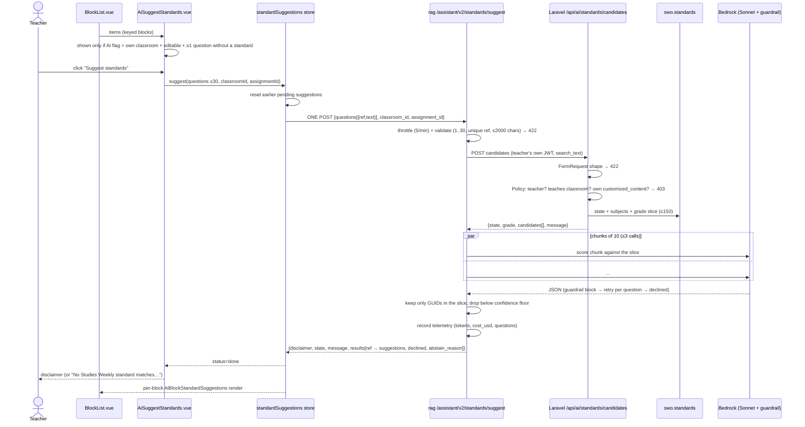
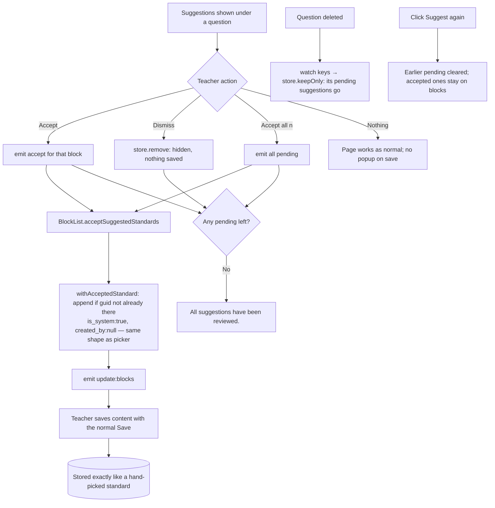
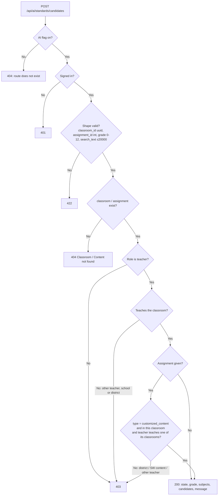

# ONLINE-7532: Suggest standards for a teacher's own questions

**Type:** Story · Teacher productivity (replaces SCOUT-07's per-question standards suggestions)

**Objective:** When a teacher explicitly asks for it, Scout suggests likely standards for the teacher's own
questions or a topic. The teacher reviews and accepts the suggestions quickly, and the way they build the
assignment isn't interrupted.

**Branches:** both repos on `ONLINE-5385_scout_ai_integration` (12 commits in `swo-3.0` and 12 in `rag`, all
tagged `ONLINE-7532`).

---

## Ticket summary

### Principles (Salman, 2026-09-27)

- Never assume what the teacher hasn't explicitly asked for. An **information request** ("which articles cover
  standard X", "what standards does this week cover") is answered only from SWO data. A **suggestion request**
  ("suggest standards that could cover this topic", or the Suggest standards button) may return AI suggestions.
- Studies Weekly content is the source of truth. Suggested codes come only from the SWO standards catalogue for
  the teacher's state.
- Teacher-written questions outside our publications get suggestions if the question is educational and passes
  the guardrails. Non-educational or personal requests are declined.
- The regular flow is never blocked: no dialog on save and no required step.
- Every suggestion set is labelled: "Suggested by AI. It can make mistakes, so please review before accepting."
- The feature sits behind the AI feature flag. Users without the flag see no change and make no request.

### Acceptance criteria

1. One request per click, whatever the number of questions (up to the cap).
2. No suggestion is written unless the teacher accepts it. Once accepted, a standard is indistinguishable from
   a hand-picked one.
3. The disclaimer is shown with every suggestion set, both on the page and in chat.
4. Users without the AI flag see no change on the page, and no request is made.
5. Suggested codes always exist in the SWO standards catalogue for the teacher's state.
6. Information requests about Studies Weekly content never return AI suggestions (a test set of lookup requests
   gets 0 suggestions).
7. Non-educational or personal requests are declined, and every request passes the guardrails.
8. A quality gate is declared before release: precision on a labelled set, with the bar set before the run,
   plus a cost estimate.
9. Backend tests: happy path, 422, and 403 for the wrong role and for another district or school.

---

## Where the code is

| Layer | File | What it does |
|---|---|---|
| **frontend-v3** | `ai/components/AiSuggestStandards.vue` | The quiet "Suggest standards" button and "Accept all (n)" above the question list, plus the disclaimer or "no match" note |
| | `ai/components/AiBlockStandardSuggestions.vue` | Each question's suggestions: code chip, description, reason, and Accept / Dismiss buttons |
| | `ai/stores/standardSuggestions.ts` | Pinia store. Holds the results of the latest click only; saves nothing |
| | `ai/context/standardSuggestions.ts` | Pure logic: which questions get sent (≤30), how the reply is read, `withAcceptedStandard` |
| | `ai/services/standardsClient.ts` | Makes the single `POST /assistant/v2/standards/suggest` call |
| | `components/teachers/assignments/blocks/BlockList.vue:311` | `acceptSuggestedStandards`: adds the standard through the block's own `standards` array, the same path the picker uses |
| **rag** | `lambdas/ai_assistant/src/routers/core_router.py` `/standards/suggest` | Validates the body, calls Laravel for the catalogue, calls the engine, records cost telemetry |
| | `src/core/standards_suggest.py` | Validation (1–30 questions, unique refs, ≤2000 chars) and building the response with the disclaimer |
| | `src/core/tools/standards_client.py` | Calls Laravel `api/ai/standards/candidates` **with the teacher's own token** |
| | `src/core/engines/standards.py` | `suggest_teacher_questions`: splits into chunks of 10 per model call (≤3 calls, run in parallel), declines non-educational items, drops suggestions below the confidence floor, keeps only GUIDs from the catalogue |
| | `src/core/tools/suggest_standards.py` | The chat tool. Only runs on an explicit ask; returns a card that starts with the disclaimer |
| | `src/core/prompts/constitution.py:47` | Rule: information asks never get suggestions; Common Core is declined; no invented codes |
| | `src/utils/throttle.py` | `standards`: 5 per minute, 40 per hour, 200 per day |
| **Laravel** | `routes/api.php:1474` | `POST api/ai/standards/candidates`, behind `feature:FEATURE_FRONTEND_AI_ASSISTANT` and `throttle:30,1` |
| | `AiStandardsController` + `StandardCandidatesRequest` | Checks the request shape (422 before 403), resolves the teacher's state and grade, builds the slice. Read-only |
| | `app/Policies/AiStandardSuggestionPolicy.php` | Teacher role only; the teacher must teach the classroom; the content must be their own `customized_content` |
| | `app/Services/Standards/CandidateSlice.php` | Official `swo.standards` for the state, subject and grade, one edition per subject, capped at 150 (over the cap, ranked on the questions' text) |
| | `tests/Feature/Ai/StandardCandidatesTest.php` | 26 tests: happy path, 422, 403 (student, admin, other district, other school, other teacher's content), flag off, nothing written |
| **Quality gate** | `rag/experiments/standards_suggest_7532/GATE-v3.md`, `RESULT-v3.md` | Declared before the run. **PASS**: precision 0.848 (lower bound 0.775 against a bar of 0.60), catalogue 125/125, decline 8/8, lookup asks 0/15, cost $3.89 against a $6 cap |

### How a subject is chosen for the slice (`CandidateSlice::subjectsFor`)

1. The subjects the classroom names (normalised to `social studies` / `science`).
2. If the classroom names none, the subjects of the classroom's own publications (SWO data).
3. If those give none either, both Studies Weekly subjects.

### How the grade is chosen (`AiStandardsController::grade`)

1. The classroom's own grade.
2. Otherwise the customized content's grade (0–12).
3. Otherwise, and only when there is no classroom (a chat ask), the grade the teacher named.

### Empty-result messages

- The teacher has no state: "No state is set for this account, so there is no standards catalogue to suggest from."
- The state has no rows for a subject: "No Science standards for <State> in Studies Weekly yet."
- The class covers only some subjects: "<Class> is set up for Social Studies, so Scout only suggests Social
  Studies standards."
- Nothing matched: "No Studies Weekly standard matches these questions. You can still attach one yourself with
  Attach Standard(s)."

---

## 1. Page flow: clicking "Suggest standards" (sequence)



## 2. Accepting and dismissing (activity)



## 3. Chat: suggestion ask vs. information ask (sequence)

```mermaid
sequenceDiagram
    actor T as Teacher
    participant S as Scout (agent + constitution)
    participant Tool as suggest_standards tool
    participant L as Laravel candidates
    participant Search as search_curriculum / page data

    alt Explicit suggestion ask ("suggest standards for: …")
        T->>S: ask
        S->>Tool: texts[≤10], grade?
        Tool->>L: candidates (teacher token, classroom from teacher_scope)
        L-->>Tool: state slice
        Tool->>Tool: engine scores, declines non-educational
        Tool-->>T: card "Suggested standards" starting with the disclaimer
        Tool-->>S: "say they're in the card; never 'added'; never Studies Weekly alignments"
    else Information ask ("which standards does week 5 cover?")
        T->>S: ask
        S->>Search: SWO links only
        Search-->>S: linked standards or none
        S-->>T: answer from SWO data, or "no standard is linked in Studies Weekly" (no AI suggestion)
    else Other framework ("Common Core codes for…")
        S-->>T: not in your catalogue; offers the state's standards instead
    else Non-educational / personal
        Tool-->>T: declined ("doesn't look like a question for students")
    end
```

## 4. Laravel authorization for the candidates route (activity)



---

## Test cases

**Setup:** a teacher account with the AI flag, a classroom that has a state set, and a customized-content
assignment with 3–4 questions and no standards. Open DevTools → Network, filtered to `standards`.

| # | Scenario | Steps | Expected |
|---|---|---|---|
| 1 | **One request per click** | Create 12 written questions with no standards, then click Suggest standards | Exactly **one** `v2/standards/suggest` call carrying 12 questions. The button shows a spinner and can't be clicked twice |
| 2 | **Button visibility** | (a) All questions already have standards. (b) Only drawing/text-response questions. (c) District view or read-only | The button doesn't appear in any of these |
| 3 | **Flag off** | Turn off `feature_frontend_ai_assistant` for the user and reload the edit page | No button, no request in Network. `POST /api/ai/standards/candidates` directly returns **404** |
| 4 | **Nothing written without a click** | Click Suggest, don't accept, then Save and reload | No standards are attached |
| 5 | **Accept = same as hand-picked** | Accept one suggestion, Save, reload. Compare against a standard added with "+ Attach Standard" | Same chip; same `standards` entry shape in the save payload (`guid`, `number`, `description`, `is_system: true`) |
| 6 | **Dismiss / Accept all** | Dismiss one, then Accept all | The dismissed one never comes back; the count updates; "All suggestions have been reviewed." |
| 7 | **Disclaimer** | Any run with results, on the page and in chat | "Suggested by AI. It can make mistakes, so please review before accepting." shown once |
| 8 | **Codes exist in the catalogue** | Copy a suggested GUID from the response, then run the SQL below | The row exists, `official = 1`, and the state is the teacher's state |
| 9 | **Non-educational question** | Add a question such as "Remind me to call Jamie's mom at 5" or "The tablet password is 1234" | No suggestion; the note says "This doesn't look like a question for students…" |
| 10 | **Chat: information ask returns 0 suggestions** | Ask "Which standards does this week cover?" and "What articles are aligned to <code>?" | Answer comes from SWO links only (or "no standard is linked"). No "Suggested standards" card; the `suggest_standards` tool isn't called |
| 11 | **Chat: explicit ask** | "Suggest standards for this question: How did rivers shape where early settlers lived?" | A card with the disclaimer and state codes; the reply says to review the card and never says "added" |
| 12 | **Chat: Common Core** | "Give me Common Core standards for fractions" | Declined; offers the state's catalogue instead. No CCSS codes |
| 13 | **Role / tenancy (403)** | Call the Laravel route directly with a student token, a non-teacher admin token, another district's classroom, another school's classroom, or another teacher's content | **403** for each |
| 14 | **Validation (422)** | Send rag 31 questions, duplicate refs, an empty text, or >2000 chars; send Laravel `classroom_id` as `abc` | **422** with a readable message. A body that isn't JSON gets **400** `invalid_body` on the deployed Lambda (its front door parses every body first); 422 only when running locally |
| 15 | **No state / subject gap** | A teacher with no state, or a class scoped to Social Studies asked a science question | The explanatory message appears (e.g. "…is set up for Social Studies, so Scout only suggests…"), not a blank result |
| 16 | **Rate limit** | Click 6 times within a minute (change a question between clicks) | The 6th click shows rag's own throttle message under `role="alert"`; nothing changes on the page. Invalid API requests count toward the 5 per minute too |
| 17 | **Deleted question** | Run Suggest, then delete a question that has pending suggestions | Its suggestions disappear, and Accept all's count drops |

SQL for test 8:

```bash
docker exec online-db.studiesw.test psql -U estudies -d estudies_esw3 \
  -c "select state, number, official from swo.standards where guid = '<guid>'"
```

### Automated checks

```bash
# Laravel feature tests (26). WARNING: RefreshDatabase wipes the local dev DB; re-seed afterwards.
docker exec -w /online-api online-api.studiesw.test php vendor/bin/phpunit --filter StandardCandidatesTest
docker exec online-api.studiesw.test php artisan migrate:fresh --seed

# frontend-v3 pure-logic spec (includes __verify/standardSuggestions.ts)
cd /home/lenovo/swo-3.0/frontend-v3 && npx vite-node ai/context/__verify.ts

# rag check script
cd /home/lenovo/rag/lambdas/ai_assistant && uv run python tests/core/check_standards_suggest.py
```

---

## dev2 results (2026-09-30)

Teacher account with the AI flag on, Texas, grade 4 classroom `8cd5acbb-…`. Full report with screenshots:
`ONLINE-7532-test-results.docx`; the Jira comment is `jira-comment.md`.

**Summary:** UI 6/6 · API 15/15 · chat information asks 3/3 with no AI suggestion · chat explicit ask passes
with 2 defects · chat declines 2/2 · **3 findings**.

### Status per test case

| # | Test | Status | Evidence |
|---|---|---|---|
| 1 | One request per click | Partial | One request seen for a one-question run; the 12-question run wasn't done |
| 2 | Button visibility | Partial | Shown when a question has no standard; cases (a)–(c) not run |
| 3 | Flag off | Not run | Needs a teacher without the flag (`NOFLAG_TOKEN`) |
| 4 | Nothing written without a click | Partial | Nothing attached before Accept; Save + reload not checked |
| 5 | Accept = hand-picked | Not run | |
| 6 | Dismiss / Accept all | Partial | Buttons and "Accept All (1)" present; behaviour not recorded |
| 7 | Disclaimer | ✅ Pass | On the page and in the chat card (underscores show in chat, finding 3) |
| 8 | Codes in the catalogue | Partial | 4.19(A) and 4.7(A) are Texas codes; the SQL check wasn't run |
| 9 | Non-educational question | Partial | Chat decline passes; on the page, a non-curriculum question got "no match" with a reason |
| 10 | Chat information asks | ✅ Pass | 3/3 with no suggestion card; the answers themselves are wrong (finding 1) |
| 11 | Chat explicit ask | ✅ Pass, 2 defects | TX 4.7(A) card with disclaimer; reply says "I've added" (finding 2) |
| 12 | Chat Common Core | ✅ Pass | Declined; Texas standards offered; no CCSS codes |
| 13 | Role / tenancy 403 | Not run | Needs student, admin and other-district tokens or IDs |
| 14 | Validation | ✅ Pass | Laravel 422 ×4, 404, 401; rag 422 ×6, 400 for non-JSON |
| 15 | No state / subject gap | Not run | |
| 16 | Rate limit | ✅ Pass (API) | 429 "Scout can take 5 standards suggestion requests a minute…"; the page alert wasn't checked |
| 17 | Deleted question | Not run | |
| — | 30-question cap | ✅ Pass (API) | rag rejects 31 with 422; the 35-question page run wasn't done |

### Findings

1. **The standard lookup contradicts the week's own standards (medium).** On publication 568, "Which standards
   does this week cover?" lists TX K.13(C) and K.14(D) for Week 1. "What articles are aligned to TX K.13(C)?"
   (and K.14(D)) then answers "Not in this publication… I don't have anything … actually linked". Expected: Week 1
   is named. This is likely in `search_curriculum` rather than this ticket. The cause hasn't been investigated.
2. **The chat reply says "I've added an AI-suggested standard…" (medium).** Nothing is saved, but
   `suggest_standards.py:125` tells the model "never that you added or attached them" (rag `64099335`), and the
   model ignored it. It also says "card above" when the card is below. A fixed reply that doesn't depend on the
   model would prevent this.
3. **Literal underscores in the chat card (low).** rag's `_markdown()` wraps the disclaimer and each reason in
   `_…_`, and frontend-v3's `utils/safeMarkdown.ts` supports bold but not italics.

### Observations (not failures)

- rag's rate limit counts invalid requests too, because it's checked before the body is read. The page never sends
  invalid requests.
- The first Texas candidate has code `"1"`, a science strand heading. If it's ever suggested, the chip would read "1".
- dev2's 404 response includes the exception class and server file path (debug output on).
- The Common Core reply refers to the teacher in the third person ("this teacher's… their Texas standards").

## Files in this folder

| File | What it is |
|---|---|
| `ONLINE-7532.md` | This document: how it works, diagrams, test plan, dev2 results |
| `ONLINE-7532-test-results.docx` | The report to attach to Jira (11 tables, 8 screenshots) |
| `jira-comment.md` | The comment to paste, in Jira formatting |
| `ONLINE-7532-api-tests.sh` | API checks: `SWO_TOKEN`, optional `CLASSROOM_ID`, `RAG_URL`, and the tokens and IDs for the 403 checks |
| `report_content.py` | The Word document's content; rebuild from the parent folder with `uv run --no-project --with python-docx python make_test_results_docx.py ONLINE-7532` |
| `screenshots/` | 01–02 page, 03–05 chat information asks, 06 explicit ask, 07 Common Core, 08 non-educational |

## Worth checking while you test

- **Questions past 30 are dropped quietly.** `questionsNeedingStandards` stops at 30, and the page doesn't say
  that questions 31 and on weren't sent. Try it with 35 questions. It meets "up to the cap", but it arguably
  breaks the "never truncate silently" rule.
- **A standard with no code sends its raw GUID instead.** The gate report found `CandidateSlice` uses the GUID
  when `number` is null. Bedrock's PII guardrail read one such GUID as a credit-card number and blocked a whole
  run (P54, a South Carolina grade-3 run). The report lists it as an out-of-scope follow-up.
- **The button needs a classroom in the URL.** It only appears when `classroom_id` is in the route, so check
  that it shows on the **create** page as well as edit.
