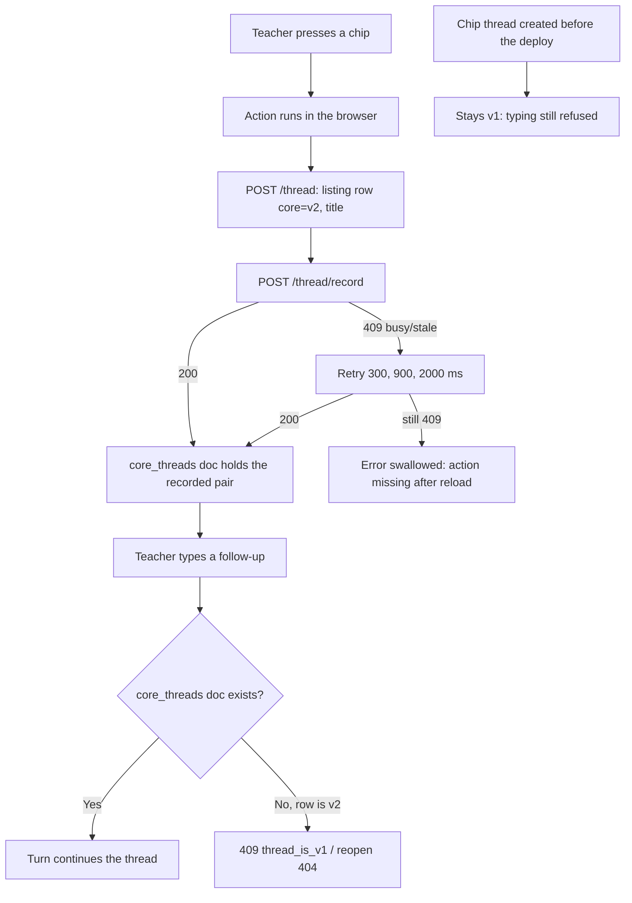
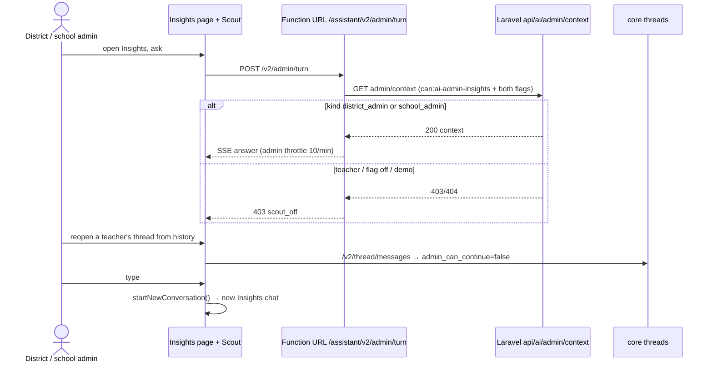
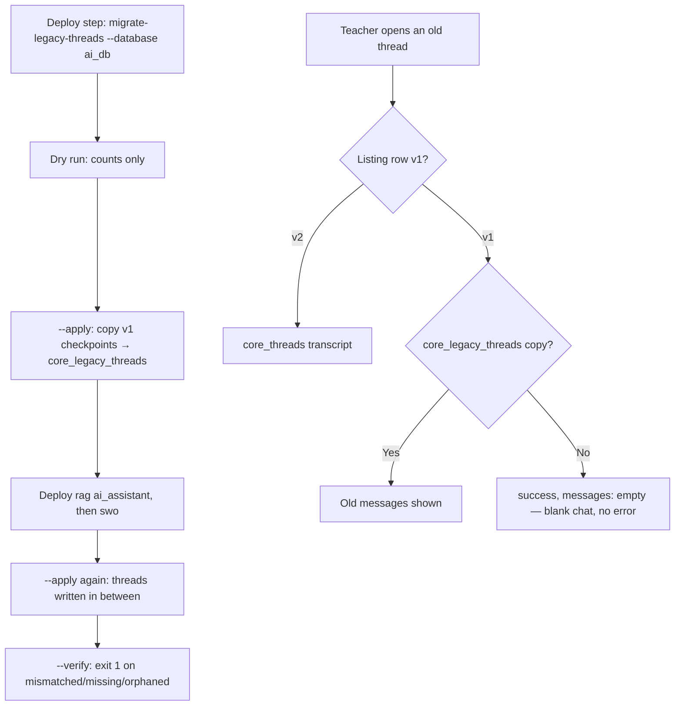

# ONLINE-8093: Scout release 2 (cleanup, guardrail, write_artifact, LangChain removal, fast model)

**Type:** Tech debt + release QA · Scout end to end for teachers, district admins and school admins

**Objective:** Scout still works end to end on dev for a teacher, a district admin and a school admin after the
cleanup (dead routes, unused code and Caylent-era docs removed) and the four ONLINE-8093 changes merged with the round
2 tech-debt tickets (ONLINE-7970, 8027, 8050 to 8064), and every doc in `docs/scout/` matches the code.

**Branches:** both repos on `ONLINE-5385_scout_release_2` (swo !6354 at `41ace7e971`, rag !101 at `de38e41b`).
Replaces the earlier MRs swo !6348 and rag !103.

---

## Ticket summary

### What changed (author's message, 2026-10-26)

- **Cleanup.** The Caylent-era docs are replaced by `docs/scout/`. Removed: the old AI search controller,
  `config/ai.php`, AI packages and the redeem endpoints. `AI_SEARCH_URL` and `NUXT_ENV_AI_SEARCH_URL` are no longer
  read. On rag, 23 unused API Gateway resources (1 integration, 13 routes, 9 Lambda permissions) are removed.
- **Guardrail.** The content check reads only the teacher's typed text, so history topics are no longer wrongly
  blocked. Production needs `guardrail_curriculum_enabled = true` (now set in `prod.tfvars`, `de38e41b`).
- **write_artifact.** Plain-text plans are parsed, and replies say K–8.
- **LangChain/LangGraph removed.** A thread started from a chip can be continued by typing (it used to give a 409).
  Each thread gets one title from core `generate_title`. `migrate-legacy-threads` copies old threads into
  `core_legacy_threads`.
- **Fast model.** Fast-model calls run with thinking off.
- **Round 2 tech debt.** ONLINE-7970 (District Insights batching), 8027 (dialog split; chat opened from search is
  revealed in the sidebar), 8050–8064 (action drift, row locks, eager access, per-route throttles, JSON caps,
  aiFetch timeout, event check, uv.lock images, admin throttle, fixed apology + request id, prune cap, pooled
  httpx, lease release), ONLINE-7806 (Insights starts a new chat instead of continuing a teacher's thread).

### Acceptance criteria (as stated, numbered for testing)

1. Scout works end to end on dev as a **teacher**, a **district admin** and a **school admin** (QA guide "Scout
   release 2: ONLINE-8093 QA guide").
2. Removed routes are gone and nothing that is still used broke.
3. History/curriculum asks are not wrongly blocked; harmful asks still are.
4. Plain-text lesson plans are written; no reply says "K-12".
5. A chip-started thread can be continued by typing; each thread gets one title.
6. Old (pre-v2) threads still open after `migrate-legacy-threads`.
7. Measured: no chain that passes on production fails on the branch (G1 0/16); works-well 147 vs 132; content-check
   blocks 6 → 0; failed lesson-plan writes 5 → 2; "K-12" replies 6 → 0; TTFT p50 within 1.2× (4882 vs 4080 ms).
8. Every doc in `docs/scout/` matches what the code does now. Known gaps named by the author: the legacy-thread
   migration and `guardrail_curriculum_enabled` (both added in `d5e30b9752`).

---

## Where the code is

| Layer | File | What it does |
|---|---|---|
| **frontend-v3** | `ai/services/aiHttp.ts:116` | All AI calls; JWT + `?host=`; `AI_DEFAULT_TIMEOUT_MS = 90_000` (ONLINE-8056) |
| | `ai.config.ts:27` | `NUXT_ENV_AI_URL` (gateway, must end in `/v3`) and `NUXT_ENV_AI_CORE_URL` (Function URL) |
| | `ai/composables/useAiActionRecord.ts:120,160` | Chip run → title → `POST /assistant/thread/record`; swallows a final failure |
| | `ai/services/retryOnConflict.ts:1` | Record retry on 409: `[300, 900, 2000]` ms |
| | `ai/composables/useAiThreads.ts` | Sidebar paging; `loadHistoryUntil` (search reveal, `f9a4c18ab3`); `adminCanContinue` from the replay |
| | `ai/composables/useAiChat.ts:2362` | Admin audience + `!adminCanContinue` → `startNewConversation()` before sending (ONLINE-7806) |
| | `ai/services/coreStream.ts:819` | `not_found` error shown as its own sentence, no failure card |
| | `utils/aiAssistantAccess.ts` | Teacher vs admin door; demo/preview accounts never get admin Scout |
| | `pages/districtadmin/reports/insights.vue`, `pages/school-admin/reports/insights.vue` | Admin Scout (Insights) |
| **rag** | `src/core/lambda_stream.py:533-575` | Function URL door: path check (404) → `verify` (teacher: `user/credits`; admin: `admin/context`) → spend cap 429 → in-flight lease 429 → throttle |
| | `src/routers/core_router.py:218,255,567` | `/assistant/v2/admin/turn`, `/turn/cancel`, `/thread/messages` |
| | `src/routers/assistant_router.py:110-334` | Gateway thread routes: create (title), listing, messages, rename, pin, record, search, delete |
| | `src/core/threads.py:135-145,410,685` | `load_thread` (`thread_is_v1`), record 409 on a running turn, `admin_can_continue` in the transcript |
| | `src/core/guardrail_route.py:200-235` | Teacher text wrapped in `guardContent`; classifier pinned to Haiku 4.5 |
| | `src/core/context/shortcut.py:135` | Shortcut instructions go in their own block (not wrapped as `guardContent`) |
| | `src/core/engines/plan_build.py:256,307` | Plain-text plan parsing (`_plain_steps`) and run-in steps |
| | `src/core/engines/llm.py:152-158` | Fast-model calls get thinking off in `_request` (`ec5e9db5`) |
| | `src/utils/throttle.py:41,60` | `chat` and `admin`: 10/min, 100/hour, 600/day |
| | `src/services/daily_usage_service.py` | Spend caps: $5/day, $2.50/week; $10/week for staff (`raised_spend_cap`) |
| | `commands/migrate_legacy_threads_command.py` | Dry run / `--apply` / `--verify`; needs `--database <ai_assistant db>` |
| | `infra/swo/envs/{dev,prod}.tfvars` | `guardrail_curriculum_enabled = true` in both |
| | `infra/swo/modules/api-gateway/routes.tf` | Only `/v3/assistant/{proxy+}`, `/v3/level-content`, `/v3/revise-question`, all on `development` |
| **Laravel** | `routes/api.php:1539-1720` | `api/ai/*`: credits, stats, actions, per-route throttles, aliases, admin (`can:ai-admin-insights` + both flags) |
| | `app/Http/Middleware/EnforceSingleActiveSession.php:38-46` | Exempts every `api/ai/*` path for Scout-flagged users |
| | `app/Http/Controllers/AiController.php:58-74` | `user/credits` teacher-only (404 for admins); `raised_spend_cap` for staff emails |
| | `tests/Feature/AiUnusedRoutesRemovedTest.php` | 10 removed routes return 404 |
| | `tests/Feature/{ScoutServiceSessionTest,AiPayloadSizeLimitTest,ScoutRouteThrottleTest,AdminInsightsTest}.php` | Session exemption, 422 caps, per-route 429, Insights batching |
| **Quality gate** | `rag/experiments/integration_8093/PLAN.md`, `RESULT.md` | Declared before rows (`8d13dda6` → `ce3e2f16`). **PASS G1–G3**: G1 0/16, works-well 147 vs 132, TTFT 1.197× (bar 1.2×), n=1. Haiku 5.5 held (1.21×). Rows are in gitignored `teacher_eval/runs/` |

### Which door a request uses

1. Sidebar, rename, pin, delete, record, search → API Gateway `<NUXT_ENV_AI_URL>/assistant/thread/*` (base ends
   `/v3`).
2. A chat turn → Function URL `/assistant/v2/turn` (teacher) or `/assistant/v2/admin/turn` (admin, Insights).
3. Reopening a v2 thread → `/assistant/v2/thread/messages`; a v1 thread reads `core_legacy_threads`.

### User-visible messages

- Admin Scout off / not an admin: `403 scout_off`.
- Too many turns at once: `429 too_many_turns`. Spend cap: 429 with the daily or weekly cap message.
- A thread the service can't find: "I couldn't find that conversation." (no AI-service failure card, `41ace7e971`).
- Unexpected failure: the fixed apology plus a request id (ONLINE-8061).

---

## 1. A teacher's turn (sequence)

```mermaid
sequenceDiagram
    actor T as Teacher
    participant UI as AiAssistantDialog / useAiChat
    participant GW as API Gateway /v3/assistant/thread
    participant FU as Function URL /assistant/v2/turn
    participant L as Laravel api/ai
    participant G as Guardrail route
    participant M as Bedrock

    T->>UI: type ask
    UI->>GW: POST /thread (new thread) → one title from generate_title
    UI->>FU: POST /v2/turn (JWT, ?host)
    FU->>FU: path under /assistant/v2/ else 404
    FU->>L: GET user/credits (teacher only; admin → 404 → scout_off)
    FU->>FU: spend cap ($5/day, $2.50/wk, $10 staff) → 429
    FU->>FU: in-flight lease → 429 too_many_turns; throttle chat 10/min
    FU->>G: classify typed text (Haiku 4.5) → CURRICULUM or OTHER
    G->>M: input check on guardContent (typed text only); output always checked
    M-->>FU: stream
    FU-->>UI: SSE turn.start … text … turn.end
    UI-->>T: reply
```

## 2. Chip-started thread, then typing (activity)



## 3. Admin Scout on Insights (sequence)



## 4. Legacy thread migration and reopening (activity)



---

## Test cases

**Setup:** three dev accounts with `feature_frontend_ai_assistant` on: a **teacher** with a classroom and a
publication; a **district admin** and a **school admin**, each also with `FEATURE_FRONTEND_AI_ADMIN_ASSISTANT`. Ideally one
teacher who had Scout threads **before** this release. Open DevTools → Network, filtered to `assistant`. Confirm with
the deployer that dev runs swo `41ace7e971` and rag `de38e41b`, and whether `migrate-legacy-threads --apply` has run
on dev.

| # | Scenario | Steps | Expected |
|---|---|---|---|
| 1 | **Teacher: a plain chat turn** | Open Scout on any `/beta` page, ask "What is this week about?" | One `POST …/v2/turn` (200, SSE) and, for a new chat, one `POST …/v3/assistant/thread`. Reply streams; the chat appears in the sidebar with one title |
| 2 | **Gateway base ends in /v3** | Look at the sidebar requests | Every sidebar call is `…/v3/assistant/thread/…`; none 404 |
| 3 | **Title has no student name** | On a roster page, ask "How is Student 3 doing?" in a new chat | The sidebar title doesn't name a student (pseudonym or real name) |
| 4 | **History topic not blocked** | Open a history article (e.g. war, slavery, Loyalists), ask "Make a lesson plan on this article" | A plan, no "content check" block |
| 5 | **Harmful ask still blocked** | Ask something clearly unsafe (e.g. how to make a weapon) | Blocked by the guardrail |
| 6 | **Shortcut text is guarded** | Save a shortcut whose instructions are unsafe; run it with a benign typed ask ("lesson plan on WWII") | Expected: blocked. Risk: only the typed text is input-checked (`guardrail_route.py:229`, `shortcut.py:135`) |
| 7 | **Plain-text lesson plan** | Ask Scout to write a lesson plan from an article whose Studies Weekly plan is plain text (no bold labels, no numbers) | The plan is written with steps; no "Kept 0 of 0 steps" |
| 8 | **Plan with one run-in line** | Paste a plan: "Lesson Plan:", "Warm-up: Ask students what they know about maps…", "Discuss the article." and ask to save it | All paragraphs become steps. Risk: only the run-in line is a step (`plan_build.py:307`) |
| 9 | **K–8 wording** | Ask "Make a lesson plan for my students" and a follow-up | No reply says "K-12" |
| 10 | **Chip → type to continue** | Press a chip (e.g. a suggested action), wait for it to finish, then type a follow-up in the same chat | The follow-up answers in the same thread; no 409 |
| 11 | **Chip during a typed turn** | Start a long typed ask; while it streams press a chip; reload | Expected: the chip's action is in the transcript. Risk: record 409s for ~3 s then is dropped (`retryOnConflict.ts:1`) |
| 12 | **Old thread opens** | Open a chat from before the release | Its old messages show. If empty, check whether the migration ran on dev (blank with no error = not migrated) |
| 13 | **Old chip thread** | Type into a chip-started thread created before the release | Refused (stays v1); note the message |
| 14 | **Search reveals the chat** | Use chat search to open a chat far down the history | The chat opens, the sidebar loads pages until it holds the row, scrolls to it and highlights it |
| 15 | **Stop / cancel** | Press Stop before the first token; also start a New Chat mid-turn | `POST …/v2/turn/cancel` 200; "You stopped this answer before it started." |
| 16 | **District admin: Insights Scout** | As the district admin open `/beta/districtadmin/reports/insights`, ask "Which schools are behind on assignments?" | `POST …/v2/admin/turn` 200; an answer from district data |
| 17 | **School admin: Insights Scout** | As the school admin open `/beta/school-admin/reports/insights`, same ask | Answer scoped to the admin's school only |
| 18 | **Admin can't continue a teacher thread** | As an admin, reopen a thread the model spoke in as a teacher (if visible), then type | A new Insights chat starts (ONLINE-7806); no not_found |
| 19 | **Admin exports** | On Insights, export District summary / Principal brief | File downloads; 11th export in a minute is 429 |
| 20 | **Teacher can't use admin door** | API script: teacher token on `/v2/admin/turn` | **403** `scout_off` |
| 21 | **Admin on teacher credits** | API script: admin token on `GET api/ai/user/credits` | **404** |
| 22 | **Flag off** | A teacher without `feature_frontend_ai_assistant` | No Scout button; `GET api/ai/user/credits` with that token as per API script |
| 23 | **Removed routes** | API script | 10 Laravel routes 404 (`generate/question`, `article/difficulty`, `adapt`, `random-article`, `credits/purchase`, `credits/expire`, `feedback` POST, `credits/packages`, `user/credits/redeem`, `search-index/1`); unprefixed gateway `/assistant/thread/listing` and `/v3/generate` 404 |
| 24 | **Unknown Function URL path** | API script: `…/assistant/v1/x` on the Function URL | **404** `not_found` |
| 25 | **Throttles** | 11 chat turns in a minute (teacher), and the same as admin | 11th is 429 with the throttle message |
| 26 | **Payload caps (422)** | API script: `POST api/ai/stats` with a `response` over 512 KB | **422** "may not be larger than 512 KB"; nothing written |
| 27 | **Single session** | Sign in on device A, then on device B; on A open Scout and ask | Expected per product: A is signed out. Note what happens: `api/ai/*` is exempt for Scout users (`EnforceSingleActiveSession.php:40`) |
| 28 | **Fixed apology + request id** | If any turn fails (5xx) | The fixed apology with a request id; record the id |
| 29 | **Docs walk-through** | Follow `docs/scout/local-setup.md`, `deploy-and-environments.md`, `troubleshooting.md` against what you saw | Every command, URL and message matches; list mismatches |

Flags are per-user settings (`User::isFeatureFlagEnabled` reads `settings()`, lower-cased keys such as
`feature_frontend_ai_assistant`). Check them in the user payload in the Network tab rather than in SQL.

### Automated checks

Browser and API checks for cases 1-4, 9, 10, 12, 14-18 and 20-26 are in `~/ldc/e2e` (Playwright, outside both
repos; coverage table in its README):

```bash
cd ~/ldc/e2e && cp .env.example .env    # accounts, E2E_GW_URL, E2E_CORE_URL
./run.sh --project=api                  # no credits
E2E_AI_TURNS=1 ./run.sh --project=ui    # sends real Scout turns
```

```bash
# Laravel feature tests. WARNING: RefreshDatabase wipes the local dev DB; re-seed afterwards.
docker exec -w /online-api online-api.studiesw.test php vendor/bin/phpunit \
  --filter 'AiUnusedRoutesRemovedTest|ScoutServiceSessionTest|AiPayloadSizeLimitTest|ScoutRouteThrottleTest|AdminInsightsTest|AiActionControllerTest'
docker exec online-api.studiesw.test php artisan migrate:fresh --seed

# frontend-v3 pins (86 suites; run from a full swo checkout). Passed 86/86 at 41ace7e971.
cd /home/lenovo/swo-3.0/frontend-v3 && npm run test:ai-pins && npm run test:ai-pins -- --verify

# rag offline checks (what CI runs), plus the top-level ones CI skips
cd /home/lenovo/rag/lambdas/ai_assistant && tests/run_checks.sh
for t in tests/check_*.py; do uv run python "$t" >/dev/null || echo "FAIL $t"; done   # check_route_errors.py fails (deleted search_index)
```

---

## Local results (2026-10-26)

Local stack (swo `41ace7e971`, rag `de38e41b`), accounts `utteacher`, `utdistrictadmin`, `utschooladmin`, automated
with `~/ldc/e2e`. Full report: `ONLINE-8093-test-results.docx`; the Jira comment is `jira-comment.md`.

**Summary:** UI 11/11 run · API 14/15 run (1 fails on a multi-role account, not a defect) · **0 findings** · 3
observations.

### Status per test case

| # | Test | Status | Evidence |
|---|---|---|---|
| 1 | Teacher plain turn | ✅ Pass | Screenshot 1 |
| 2 | Sidebar / gateway | Partial | Chat list 200 with no errors; `/v3` path not checkable locally (no API Gateway) |
| 3 | Title has no student name | ✅ Pass | One generated title, no "Student N" |
| 4 | History topic not blocked | ✅ Pass | Screenshot 3 |
| 5 | Harmful ask blocked | Not run | Manual |
| 6 | Shortcut text guarded | Not run | Manual |
| 7 | Plain-text lesson plan | Not run | Manual |
| 8 | Plan with a run-in line | Not run | Manual |
| 9 | K–8 wording | Partial | No "K-12" in one lesson-plan reply |
| 10 | Chip → type | Not run | No chip label chosen |
| 11 | Chip during a typed turn | Not run | Manual |
| 12 | Old thread opens | Not run | No v1 chats for `utteacher` locally; `core_legacy_threads` empty |
| 13 | Old chip thread | Not run | Manual |
| 14 | Search reveals the chat | ✅ Pass | Screenshots 5-6 |
| 15 | Stop / cancel | ✅ Pass | Screenshot 4 |
| 16 | District admin Insights Scout | ✅ Pass | Screenshots 7-8 |
| 17 | School admin Insights Scout | ✅ Pass | Screenshots 9-10 |
| 18 | Admin can't continue a teacher thread | Partial | No error; the reopened chat was the admin's own |
| 19 | Admin exports | Not run | Manual |
| 20 | Teacher on the admin door | Not run | No Function URL front door locally |
| 21 | Credits / admin context per role | Partial | Teacher and school admin pass; `utdistrictadmin` is also a teacher (200) |
| 22 | Flag off | Not run | No flag-off account |
| 23 | Removed routes | Partial | 10 Laravel routes 404; gateway routes need dev |
| 24 | Unknown Function URL path | Not run | Needs dev |
| 25 | Throttles | Not run | Manual |
| 26 | Payload caps (422) | ✅ Pass | API run |
| 27 | Single session | Not run | Manual |
| 28 | Fixed apology + request id | Not run | Manual |
| 29 | Docs walk-through | Not run | Manual |

### Findings

None from this run. Code-review findings are in `mr-review-comments.md`.

### Observations (not failures)

- Local setup: `FEATURE_FRONTEND_AI_ADMIN_ASSISTANT = true` added to `backend/.env`; no queue worker runs locally, so
  the Insights figures job was processed once with `queue:work --queue=report --stop-when-empty`.
- One early teacher turn failed with "The AI service returned an error" (ref `90385ded-…`, `model_error`, 0 model
  calls); later turns all completed.
- A reopened stopped-before-start answer shows only "Stopped".

## Files in this folder

| File | What it is |
|---|---|
| `ONLINE-8093.md` | This document: how it works, diagrams, test plan, local results |
| `ONLINE-8093-test-results.docx` | The report (4 tables, 10 screenshots) |
| `jira-comment.md` | The comment to paste, in Jira formatting |
| `ONLINE-8093-api-tests.sh` | Shell API checks for dev2 (tester's own tokens) |
| `mr-review-comments.md` | File:line review comments for swo !6354 and rag !101 |
| `report_content.py` | The Word document's content; rebuild with `uv run --no-project --with python-docx python make_test_results_docx.py ONLINE-8093` |
| `screenshots/` | 01-06 teacher, 07-08 district admin, 09-10 school admin |

## Worth checking while you test

- **Old chats can open blank.** A v1 thread with no `core_legacy_threads` copy returns `success: true, messages: []`
  with no log (`threads.py:451-456`). `deploy-and-environments.md` says to migrate "after the rag release", so every
  old chat is blank between the deploy and the migration.
- **Shortcut instructions skip the input guardrail and the classifier** (test 6). With the curriculum profile now on
  in prod, a harmful shortcut plus a benign typed ask can run under the relaxed profile.
- **A chip pressed during a typed turn loses its record** after ~3.2 s of retries (test 11).
- **Title-then-record window.** The listing row is v2 before `core_threads` exists; a typed turn in that window gets
  `thread_is_v1`, and if the record never lands the thread can't be typed into again.
- **Admin reopening while a thread loads.** `selectThread` sets `adminCanContinue = false` before the replay arrives,
  so an admin who types during the load starts a new chat.
- **Thread titles and relevance still call `converse` directly** (`threads.py:666`, `context/relevance.py:199`), so
  "fast-model calls never think" doesn't cover them. No effect while fast is Haiku 4.5.
- **Generate questions has a 90 s browser timeout** (`aiHttp.ts:116`) against a 210 s Lambda; try a 10-question set.
- **The prod curriculum guardrail version was never screened**; the gate used dev v4. Dev results don't prove prod.
- The integration rows (`teacher_eval/runs/int-*.jsonl`) are gitignored, so the headline numbers can't be re-scored
  from the repo.
